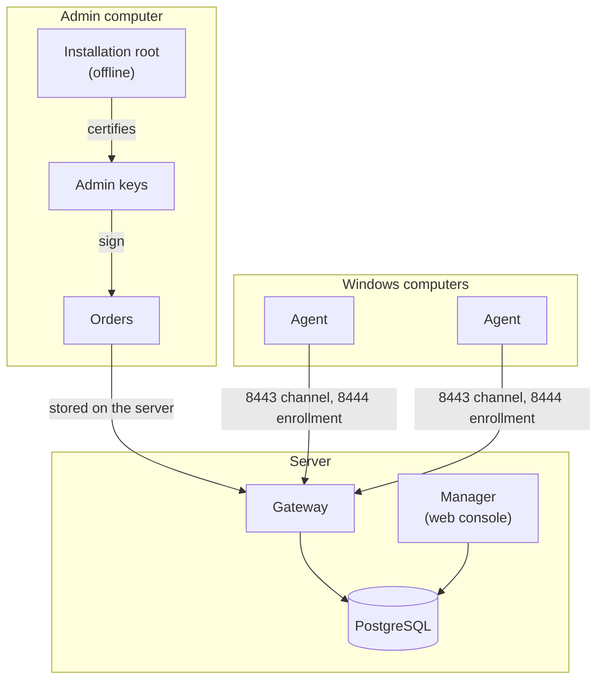

Greenhold has three kinds of part.

- The **admin computer** holds the installation root and the admin keys. It is offline from the server.
- The **server** runs the gateway, the Manager and PostgreSQL.
- The **agents** run on your Windows computers.

## The flow

1. An administrator signs an Order with an admin key.
2. The server stores the signed Order.
3. Each agent connects out to the gateway.
4. The gateway tells the agent about its Orders.
5. The agent fetches the Order and checks the signature.
6. The agent runs the Order only when the signature is valid.
7. The agent reports the result to the gateway.

No agent listens for connections.
The agents connect out.
You open no inbound port on any agent computer.

:::note
The agent judges every Order itself.
It does not trust the server.
It trusts only the installation root.
:::

## The parts of the server

| Part | Job |
|---|---|
| Gateway | Accepts agent connections on ports 8443 and 8444. It stores devices and Orders in PostgreSQL. |
| Manager | The web console. Administrators sign in through your identity provider. It reads the database with a read-only role. |
| PostgreSQL | Holds the devices, Orders, Runs and the audit trail. |

:::tip
A backup of the database is a backup of the device list.
Without it, every agent must enroll again.
:::
