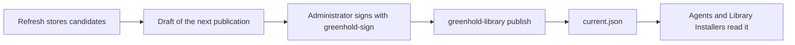

A **library** holds the software that you deploy.
A library keeps **packages**.
A package is one piece of software with its stored versions.

A library does not depend on the server.
You can use a library with agents, with the Library Installer on image masters, or with both.

:::note
Without a license, you can add at most 5 packages to a library.
A license removes this limit.
:::

## Where a library lives

| Place | Address | Notes |
|---|---|---|
| Folder or file share | A full path or a UNC path | Use a Windows file share with SMB 2 or later. Greenhold refuses a share that cannot lock files in the right way. |
| Azure Blob | `https://<account>.blob.core.windows.net/<container>[/<folder>]` | Use a storage account with account key access turned off. The writer signs in with a certificate or a managed identity. |

The layout is the same in both places.
These items are the main ones:

| Item | Content |
|---|---|
| `library.json` | The ID of the library and the ID of the installation. |
| `catalog/` | The packages that you want, with their sources and settings. |
| `packages/` | The stored versions of each package, with the installer files. |
| `publication/` | The signed publication, the draft that waits, and the revocation list. |
| `library-installer/` | The Library Installer, in sets. Each version has its own folder. |
| `logs/` | The logs of each refresh and each automatic publication. |

Storage access decides who can read and change the files.
The signature of an administrator decides what a reader accepts.
A person who can write to the library cannot make a computer install something that no administrator signed.

## Sources

A package has a **source**.
The source tells the refresh where to find new versions.
A source is a query.
It is never code that you write.

| Source | Finds |
|---|---|
| WinGet | The latest version in the signed index of WinGet. |
| URL | A file at a fixed `https` address. Greenhold reads the version from the file. |
| PowerShell module | The result of Evergreen, Nevergreen or VcRedist. |
| None | You add each version by hand. |

:::caution
Evergreen and Nevergreen run code that they fetch.
They run it as the account of the scheduled refresh.
Give that account no other rights.
:::

## Refresh

A **refresh** is one run without a person.
It does these things:

1. It checks the source of each package.
2. It downloads new versions and stores them as **candidates**.
3. It checks the signature of each installer.
4. It writes a draft of the next publication with the candidates that are ready.
5. It removes old files by the retention rules.

A refresh never publishes.
A candidate is ready when its **cool-off** time is over.
You set the cool-off time in days.

Schedule the refresh with `greenhold-library schedule`.
Run it as an account that is not an administrator.

A refresh refuses a download from a private, loopback or link-local address.
To allow an internal mirror, set `AllowedInternalAddresses` in the policy of the refresh computer.

## Drafts, signing and publications

A **publication** states which versions the library offers.
Computers install only what a verified publication names.



1. Run `greenhold-library draft`, or use the draft that the refresh wrote.
2. Sign the draft: `greenhold-sign sign --kind publication`. Do this on your own computer. The tool lists every change before it asks for your passphrase.
3. Publish the signed file: `greenhold-library publish --file publication.signed`.

A publication has a sequence number that rises.
A reader refuses a lower sequence than the one it accepted.
A publication stops to count when its validity ends, or when the certificate of its signer ends.
The default validity is 180 days.
The longest validity is 366 days.
Sign a renewal before the end.

The Manager shows each library on the pages **Overview**, **Draft**, **Publish** and **Last refresh**.
The Manager does not sign.

### Automatic publication

A library can also publish **automatically**.
A separate program, `Greenhold.LibraryPublisher.exe`, signs with an **automation key**.
The installation root certifies that key for one library and nothing else.
The program runs as another account than the refresh.

The automatic publisher publishes only a newer version of a package that an administrator approved.
The new version must have the same signer, product and installer type.
Its cool-off time must be over.
The publisher never does these things:

- It never makes the first publication.
- It never adds or removes a package.
- It never changes a switch, a script, an exit code or a dependency.
- It never publishes an unsigned installer.

An administrator signs those changes.
An automatic publication is valid for 30 days.
An administrator must publish at least once in each validity period.
If not, readers stop to accept automatic publications.

To refuse automatic publications, set `RefuseAutomaticPublications` to 1 in the policy of the reader.
To require an administrator for every publication, set `publishing.requireAdministratorSignature` in the library.

## How an agent installs a package

An `InstallPackage` Action in a signed Release names a library and a package.
The Action has one of two forms:

| Form | What the agent installs |
|---|---|
| Pinned | The version, the installer and the whole plan that the Action names. The agent refuses a later publication that changes any item of the plan. |
| Published | Whatever the verified publication names when the Order runs. |

Make the content with `greenhold-sign install-spec`.
It pins the active version unless you give `--follow-publication`.
Read the plan that it prints before you sign.

:::caution
The published form lets a later publication change what runs.
Use the pinned form for sensitive computers.
:::

The agent reads only the libraries that its policy lists in `Libraries`.
The Release never names a location.
The agent reads a folder or a share.
It does not read an Azure Blob address yet.
It reads a share as the computer account.
Give the computers read rights on the share.

Before the agent claims the Order, it does these steps:

1. It reads the publication and verifies it against its root.
2. It plans the package and its dependencies.
3. It copies each installer and script to the folder of the Run.
4. It holds each copy open and checks its hash.

The agent refuses a package whose switches force a restart.
After the claim, the agent runs the held copies.
An MSI runs through `msiexec /norestart`.
When the library is not reachable, the Order waits.
The wait starts at 1 minute and doubles up to 30 minutes.

## The Library Installer for images

`Greenhold.LibraryInstaller.exe` installs packages on an image master.
It needs no agent.
It runs on .NET Framework 4.7.2.
The module `GreenholdLibrary` wraps it for Windows PowerShell 5.1.

```
Greenhold.LibraryInstaller.exe install --package 7zip.7zip --package Posit.RStudio
Greenhold.LibraryInstaller.exe install --all
Greenhold.LibraryInstaller.exe list
```

`install` needs an elevated prompt.
`list` changes nothing.

The Library Installer needs three settings.
They come from the computer and never from the library:

| Setting | Policy value | Meaning |
|---|---|---|
| Library | `Library` | A folder, a UNC path or an Azure Blob address. |
| Library ID | `LibraryId` | The ID of the library. |
| Root | `Root` | The public file of the installation root, on the local disk. |

The policy key `HKLM\SOFTWARE\Policies\Greenhold\LibraryInstaller` wins over the command line, the environment and the file beside the program.

For Azure Blob, set `BlobAccess`:

| Value | Reads as |
|---|---|
| `managed-identity` | The managed identity of the computer. It needs Storage Blob Data Reader on the container. |
| `sas-environment` | The read access in the variable `GREENHOLD_LIBRARY_INSTALLER_SAS`. |
| `sas-file:<full path>` | The read access in that file. Only administrators may open it. |

Make a read access with `greenhold-library issue-read-access`.
It reads only, uses `https` only, and lasts one to seven days.

| Exit code | Meaning |
|---|---|
| 0 | Everything installed or was already installed. |
| 3010 | Installed. A restart is needed. |
| 1641 | Installed. An installer started a restart. |
| 1 | A package failed. The others ran. |
| 2 | The command line is not valid. |
| 3 | The library or the publication could not be read, or the computer is not set up. Nothing installed. |
| 4 | A package that you asked for is not published. |
| 5 | The prompt is not elevated. |

The Library Installer never restarts the computer.
Use your image pipeline for the restart.

:::tip
The work folder keeps logs and results that name the master.
Delete `logs\` and `results\` in the work folder before you seal and capture the image.
The work folder is `%ProgramData%\Greenhold\LibraryInstaller`.
:::

The Library Installer set is a folder with the program and the module.
Put the set in the library with `greenhold-library publish-library-installer`.
It reaches image masters with the next publication that an administrator signs.
