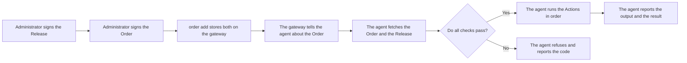

An agent runs work only when two signed objects tell it to.
The two objects are a **Release** and an **Order**.
Administrators sign both.
The server only stores and delivers them.

| Object | What it is |
|---|---|
| Release | An immutable, signed version of a Job. It lists the Actions, the hash of each script, and the names of the parameters with their allowed values. |
| Order | A signed instruction to run one Release. It names the Release by its hash. It holds the parameter values, the targets, a start time, an end time and a unique ID. |

A Release alone does nothing.
An agent runs a Release only under a valid Order.

## What a Release holds

A Release holds these items:

- The ID of the installation.
- The ID of the Job and the version of the Release. The first version is 1.
- The date of creation.
- The Actions, in order. Each Action has an ID, a type and the hash of its content.
- The parameters. Each parameter has a name and either a list of allowed values or a range of whole numbers.

An agent runs these Action types:

| Action | Job |
|---|---|
| `RunScript` | Run one PowerShell script. |
| `InstallPackage` | Install a package from a library. See [Libraries and packages](/concepts/libraries-and-packages/). |
| `Seal` | Remove the identity of the agent before you capture an image. It must be the last Action. The Order must name exactly one device. |

An agent refuses a Release with any other Action type.

:::note
The agent never restarts the computer.
When a package asks for a restart, the Run ends with the code 3010 or 1641.
Restart the computer with your own tool.
:::

### Versions

Each Release of a Job has a higher version than the one before.
An agent remembers the highest version it accepted for each Job.
It refuses a lower version.
To go back, sign the old content again as a new Release with a higher version.

## What an Order holds

An Order holds these items:

- The ID of the installation and a unique ID for the Order.
- The hash of the Release.
- The values of the parameters. Each value must fit the Release.
- The targets: a list of device IDs, or one tag.
- The times: when the Order was issued, when it starts (`notBefore`) and when it ends (`expires`).

An Order has one Run for each device.
An Order does not repeat.
To do the work again, sign a new Order.

## Who signs

An administrator signs with a personal key.
The installation root certifies each key for at most 6 months.
The root key stays offline.
Agents trust only the public key of the root.
See [Security model](/concepts/security-model/).

Make the signatures with `greenhold-sign` on the own computer of the administrator.
Never use the server for this.
A key that the server can use is not an approver.

Each signature carries the ID and the name of the administrator.
You cannot remove them from the signed object.
Use a pseudonym or a role name.
Do not use the name of a person.

### The second signer

Some Orders need two signers.
The two signers must have different administrator IDs and different keys.
The policy of the agent decides when an Order needs a second signer.

| Policy value | Effect |
|---|---|
| `SecondSignerRule` | The Order needs two signers when the agent is a server, when the Order names a tag, or when the Order names more devices than `SecondSignerAbove`. |
| `SecondSignerAbove` | The device count for the rule above. The default is 25. The count is for one Order. |
| `AlwaysSecondSigner` | Every Order needs two signers. |
| `AllowTagRelaxation` | A signed amendment with two signers can make a tag Order follow the device count. |

:::caution
The limit of 25 devices catches mistakes.
It does not stop an administrator who splits one rollout into many small Orders.
To stop this, turn on `AlwaysSecondSigner`.
:::

Add a second signature to a signed object with `greenhold-sign sign --add-to`.
The hash of the object does not change.
See [Policy for agents](/concepts/policy-for-agents/).

### Tags

A tag is a text that the local policy of a computer gives to it.
Group Policy or Intune sets the `Tags` value.
An Order that names a tag names every device that carries the tag.
An agent cannot count the devices of a tag.
For this reason, an Order for a tag needs two signers.

:::note
The gateway does not route Orders for a tag yet.
The command `order add` refuses an Order that names a tag.
Name the device IDs in the Order.
:::

## The flow of an Order



1. Sign the Release and then the Order.
2. Store them on the gateway: `Greenhold.Gateway order add --release <file> --order <file> --content <file>`. Give one `--content` file for each script.
3. The gateway queues one Run for each device in the Order.
4. The agent hears of the Order at its next look.

The command `order add` checks the form of the files.
It checks that the Order names the Release and that every script is present.
It checks that every device is enrolled.
It does **not** check the signatures.
The agent does.

## What the agent checks

The agent handles one Order at a time.
Before it runs anything, the agent checks all of these items against the root it trusts and against its own policy:

- Every signature is valid, and each signing certificate comes from the root.
- Each signing certificate is valid now, and lasts at most 6 months.
- No signer is on the revocation list of the root.
- The kind of each signing key is in `AcceptedKeyKinds`.
- The Order has the signers that the second signer rule needs.
- The Order names the Release that the agent received.
- The Order and the Release belong to the installation of the agent.
- The start time has come, and the end time has not passed.
- The Order names this device, or a tag that the device carries.
- The values fit the parameters of the Release.
- The version of the Release is not lower than the highest version that the agent accepted.
- The Order was not run before.
- Each Action has a type that the agent runs.
- The SHA-256 of each script is the one in the signed Release. The agent holds its own copy open while it runs.

The agent refuses the whole Order when one check fails.
It runs nothing.
It reports a numeric code to the gateway and writes the code in its log.

| Code | Meaning |
|---|---|
| 8 | A certificate that the root did not sign. |
| 11 | A certificate that has expired. |
| 13 | A signature that does not verify. The Order changed. |
| 14 | The policy does not accept the kind of the signing key. |
| 15 | The Order needs a second signer. |
| 17 | The Order has not started. The agent takes it again later. |
| 18 | The Order has expired. |
| 20 | The Order does not name this device. |
| 22 | A newer version of the Job was accepted before. |
| 23 | The Order was run before. |
| 27 | A signer is on the revocation list. |
| 38 | A script or content differs from the signed hash. |
| 39 | The agent cannot run the Release, for example an unknown Action type. |
| 50 | An `InstallPackage` Action names a library that the policy does not list. |

## Run output

The agent runs each script with Windows PowerShell 5.1:

```
powershell.exe -NoProfile -NonInteractive -ExecutionPolicy Bypass -File <script> -Name:value
```

It runs the Actions in order.
It stops at the first Action that does not end with exit code 0.
The whole Run must end within `RunTimeoutMinutes`.
The default is 60 minutes.

A script declares its values in `param()`.
Each value arrives as one string.
It never arrives as code.

The agent sends the output to the gateway while the script writes it.
One Run keeps at most 1 Mi characters of output.
The agent keeps output that the gateway cannot take yet.
It sends that output when a session opens again.

Read the results on the gateway:

```powershell
.\Greenhold.Gateway.exe run list --limit 50
.\Greenhold.Gateway.exe run output <order id> --device <device id>
```

`run list` shows the state of each Run, the exit code and the refusal code of the agent.

:::caution
The output of a script can hold secrets.
The gateway does not write Run output in its log.
The database keeps the output.
Do not print secrets in a script.
:::

The database deletes the output of a finished Run after 90 days.
It deletes the Run itself after 365 days.
To change the periods, use `database retention set`.
See [Command line](/reference/command-line/).
