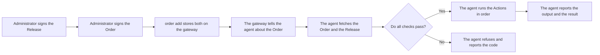

Greenhold Dispatch runs PowerShell scripts and installs software on Windows computers.
You sign the work.
The agent on each computer checks the signature before it runs anything.

Dispatch is one of two Greenhold products.
The other is [Greenhold Library](/library/overview/).
Dispatch can install packages from a library.

## What it does

- It runs a signed PowerShell script on one or more devices.
- It installs a package from a library on a device.
- It prepares a device for an image (the `Seal` Action).
- It shows the state, the exit code and the output of each Run.

## The parts

| Part | Job |
|---|---|
| Administrator computer | Holds the root and the administrator keys. Signs Releases and Orders with `greenhold-sign`. |
| Gateway | Stores the signed objects and the scripts. Tells each agent about its work. Stores the output. |
| Agent | Runs on each Windows computer. Checks every signature and every hash. Runs the script. |
| PostgreSQL | Holds the devices, Orders, Runs and the output. |

The server cannot sign.
A key that the server can use is not an approver.

[Admin Tools](/get-started/admin-tools/) makes the root and the administrator keys.
`greenhold-sign` signs Releases and Orders.

## The flow

## Where to go next

- [Run a PowerShell script on a device](/dispatch/run-a-powershell-script/)
- [Orders and Releases](/dispatch/orders-and-releases/)
- [Second signer and tags](/dispatch/second-signer-and-tags/)
- [Run output and retention](/dispatch/run-output-and-retention/)
- [Policy for agents](/concepts/policy-for-agents/)
