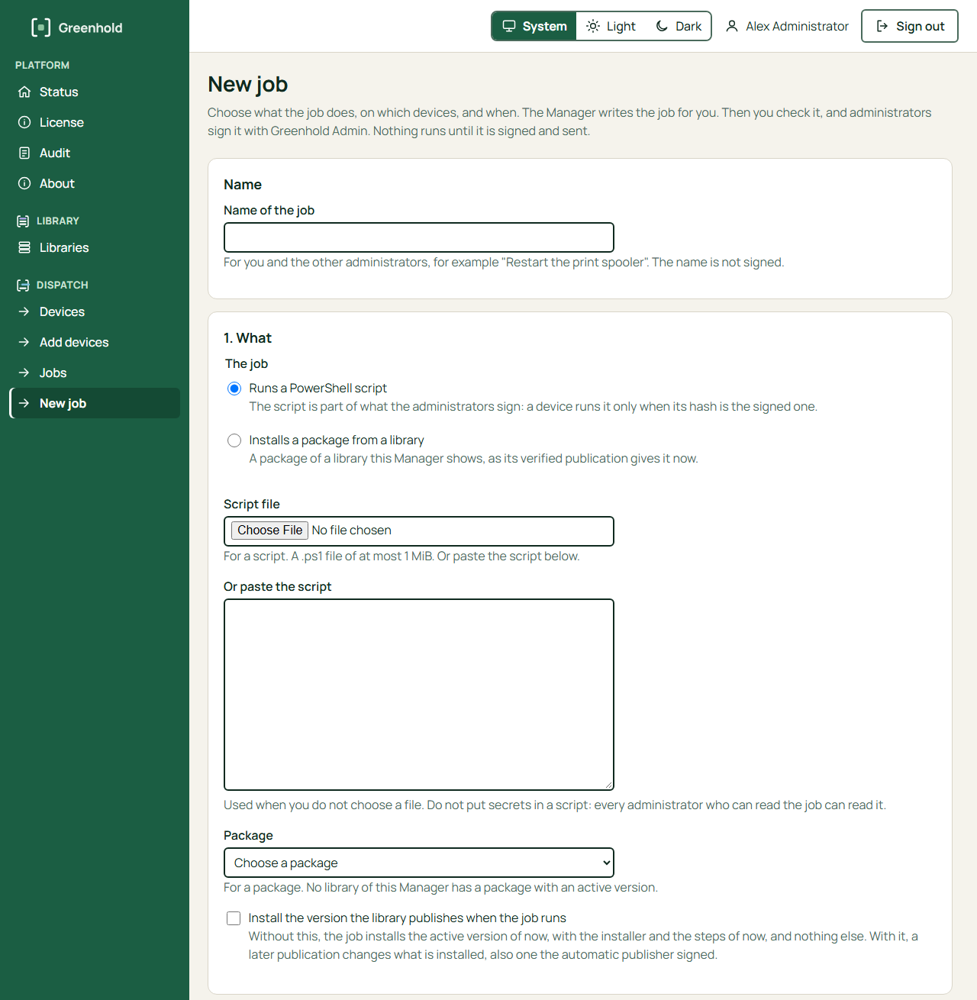
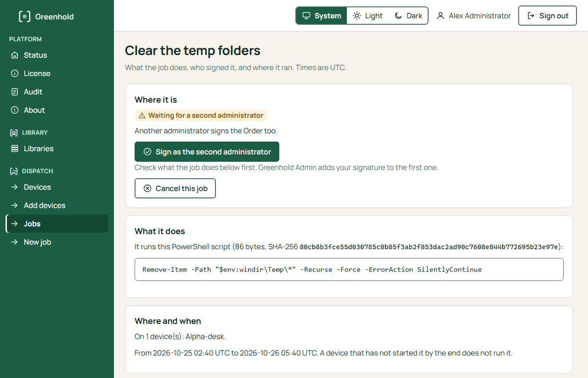
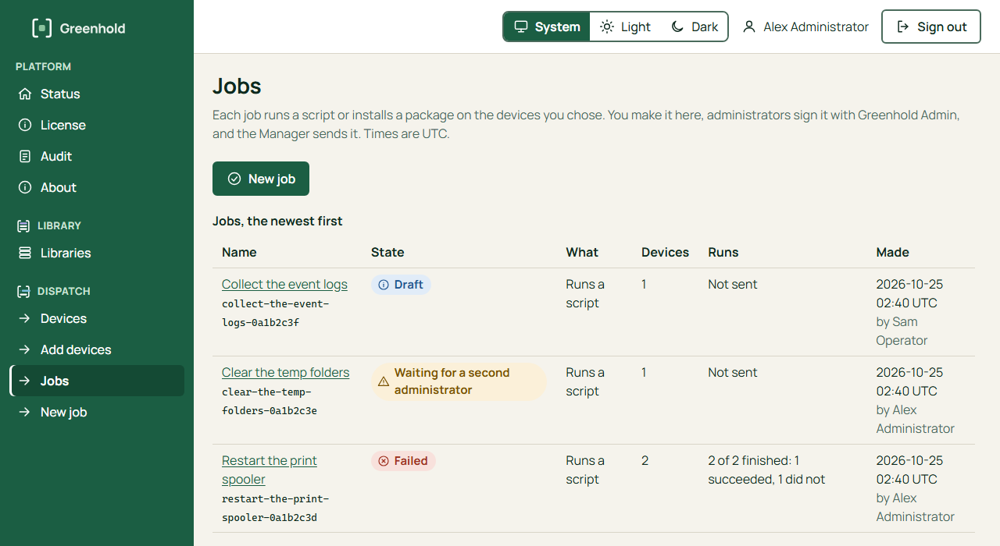
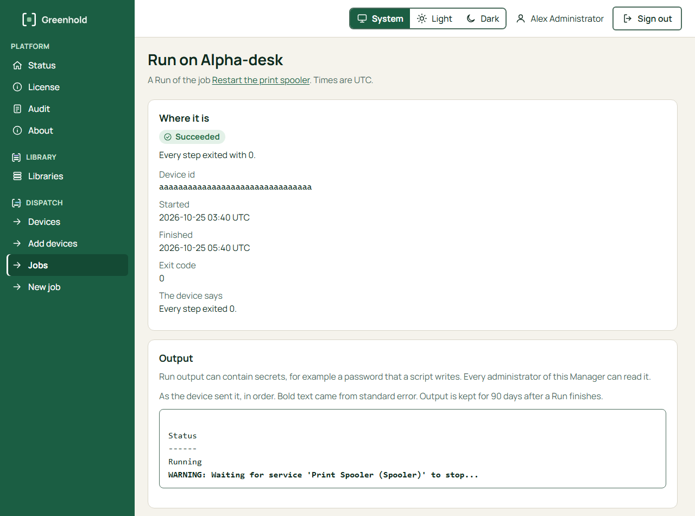

import { Tabs, TabItem } from '@astrojs/starlight/components';

This page shows the whole path for one script on one or more devices.
In the Manager, a **job** is a script or a package, the devices, and a time window.
The Manager writes the signed objects for you: a **Release** (what runs) and an **Order** (where and when).
Nothing runs until administrators sign the job and the Manager sends it.

Before you start, you need these items:

- An installation root and an administrator key with a certificate. See [Before you install](/get-started/before-you-install/).
- A running gateway and an enrolled device. See [Enroll your first device](/get-started/enroll-your-first-device/).
- Greenhold Admin on your own computer. It also installs `greenhold-sign`. Never use the server for signing.
- A second administrator key, if the Order needs two signers. See [When you need two signers](#when-you-need-two-signers).

## When you need two signers

By default, an Order needs two signers in these cases:

- The device is a server. `Greenhold.Agent.exe status` shows `Server: yes`.
- The Order names a tag.
- The device has not reported whether it is a server. It may be one.
- The Order names more than 25 devices.

The policy of the agent can change these rules.
The Manager applies the same rules to what the devices reported, and asks for a second signer when they need one.
See [Second signer and tags](/dispatch/second-signer-and-tags/).

## Find the values (command line only)

The Manager finds these values itself. On the command line, you need them for the drafts:

| Value | Where to find it |
|---|---|
| Installation ID | `installationId` in `root.public.json`. On the server, the file is `C:\ProgramData\Greenhold\Gateway\root.public.json`. |
| Device ID | The line `Device id` of `Greenhold.Agent.exe status` on the device, or `Greenhold.Gateway.exe agent list --wide` on the server. It has 32 characters. |

To read the installation ID in PowerShell:

```powershell
(Get-Content -Raw root.public.json | ConvertFrom-Json).installationId
```

## Make and sign the job

<Tabs syncKey="interface">
<TabItem label="GUI">

1. In the Manager, open **New job**.
2. Type a **Name of the job**, for example `Restart the print spooler`. The name is not signed.
3. Under **1. What**, choose **Runs a PowerShell script**. Choose the **Script file**, or paste the script in **Or paste the script**. A script has at most 1 MiB. Do not put secrets in a script: every administrator who can read the job can read it. A script with characters other than plain ASCII must be UTF-8. The Manager adds the BOM. A file in an ANSI code page with such characters is refused. See [The encoding rule](/manager/sign-with-greenhold-admin/#the-encoding-rule).
4. Under **2. Where**, tick the **Devices**. Or choose **Or every device with this tag**. The tag adds the devices that report it now. A device that gets the tag later does not get this job.
5. Under **3. When**, set the **Start (UTC)** and the **End (UTC)**. The end is at most 30 days after the start. A device that has not started the job by the end does not run it. The device's own run timeout stops a step that runs too long.
6. Under **4. Signatures**, tick **Ask a second administrator to sign in any case** if you want two signers. The Manager also asks for a second signer when the agents' rules need one. See [When you need two signers](#when-you-need-two-signers).
7. Choose **Make the job and check it**.
8. On the job page, check what the job does. Then choose **Sign with Greenhold Admin**.
9. Greenhold Admin opens the **Release** first. Read the whole script and sign. Then it opens the **Order** by itself. Check the devices, the start and the end, and sign. See [Sign with Greenhold Admin](/manager/sign-with-greenhold-admin/).



When the job has every signature that it needs, the Manager sends it to the gateway.
If the Manager cannot send it, for example because of the license, the job stays **Signed, not sent** with a **Send it** button.

The Manager checks each signature against the installation root before it keeps it.
Each device checks the signatures again before it runs anything.

**A second administrator.** When the job needs two signers, it waits with the state **Waiting for a second administrator**.
Another administrator signs in to the Manager, opens the job and chooses **Sign as the second administrator**.
Greenhold Admin adds the second signature to the first one.
The second signer must be another person, with another administrator ID and another key.



</TabItem>
<TabItem label="CLI">

**Step 1: Write the script**

The agent runs the script with Windows PowerShell 5.1.
Declare each value in `param()`.
Each value arrives as one string.

```powershell
param([string]$Name)
Write-Output "Hello $Name from $env:COMPUTERNAME"
```

Save it as `hello.ps1`.
A script with characters other than plain ASCII must be saved as UTF-8 with BOM: `greenhold-sign` adds no BOM. See [The encoding rule](/manager/sign-with-greenhold-admin/#the-encoding-rule).

:::caution
A parameter value is visible on the command line of the process.
Do not use a parameter for a secret.
:::

Get the SHA-256 of the script:

```powershell
(Get-FileHash .\hello.ps1 -Algorithm SHA256).Hash.ToLower()
```

**Step 2: Write the Release draft**

A draft is a JSON file.
The layout of the file does not matter.
Save it as `release.json`.

```json
{
  "format": 2,
  "installationId": "<installation id>",
  "jobId": "hello",
  "version": 1,
  "createdOn": "2026-10-24T12:00:00Z",
  "actions": [
    { "id": "a1", "type": "RunScript", "hash": "<sha256 of hello.ps1>", "artifacts": [] }
  ],
  "parameters": [
    { "name": "Name", "values": ["world", "lab"] }
  ]
}
```

A parameter has either `values` (the allowed text) or `min` and `max` (a range of whole numbers).
A Release without parameters has `"parameters": []`.
The version starts at 1.
Each new Release of the Job needs a higher version.

Write each time in UTC, in the form `yyyy-MM-ddTHH:mm:ssZ`.
Use the time now for `createdOn`.
To get it in PowerShell:

```powershell
[DateTime]::UtcNow.ToString('yyyy-MM-ddTHH:mm:ssZ')
```

**Step 3: Sign the Release**

```
greenhold-sign sign --kind release --draft release.json --admin-key admin.key.json --cert admin.cert --out release.signed
greenhold-sign hash --file release.signed
```

The tool asks for your passphrase.
Set `GREENHOLD_ADMIN_PASSPHRASE` or type it when asked.
Never give it as an argument.
The command `hash` prints the hash of the Release.
You need it in the Order.

**Step 4: Write and sign the Order**

Save the Order draft as `order.json`:

```json
{
  "format": 2,
  "installationId": "<installation id>",
  "orderId": "order-0001",
  "releaseHash": "<hash from greenhold-sign hash>",
  "issuedOn": "2026-10-24T12:00:00Z",
  "notBefore": "2026-10-24T12:00:00Z",
  "expires": "2026-10-25T12:00:00Z",
  "targets": { "devices": ["<device id>"] },
  "values": { "Name": "world" }
}
```

Each parameter of the Release needs a value.
The value must fit the Release.
A Release without parameters needs `"values": {}`.
Give each Order its own `orderId`.

Set `issuedOn` and `notBefore` to the time now, or a little earlier.
The agent waits for an Order whose `notBefore` is in the future.
Set `expires` to a time after the agent can run the Order, for example 2 hours from now.
The agent refuses an Order after `expires`.

```
greenhold-sign sign --kind order --draft order.json --admin-key admin.key.json --cert admin.cert --out order.signed
```

If the Order needs a second signer, the second administrator adds a signature:

```
greenhold-sign sign --add-to order.signed --admin-key <key folder 2>\admin.key.json --cert <key folder 2>\admin.cert --out order2.signed
```

Then use `order2.signed` in the next steps.
See [Second signer and tags](/dispatch/second-signer-and-tags/).

**Step 5: Check like an agent**

```
greenhold-sign verify --order order.signed --release release.signed --root root.public.json --device-id <device id>
```

The tool prints `ACCEPTED`, or `REFUSED` with a code.
Add `--server` when the device is a server.
This check does not replace the check of the agent.

**Step 6: Store the Order on the gateway**

Copy these files to the gateway computer:

- `release.signed`
- `order.signed`, or `order2.signed` with two signers
- `hello.ps1`

The files hold no secret.
Run these commands in an elevated PowerShell on the gateway computer, in the folder with the files:

```powershell
$gw = 'C:\Program Files\Greenhold\Gateway\Greenhold.Gateway.exe'
& $gw order add --release release.signed --order order.signed --content hello.ps1
```

The command prints this line:

```
Order order-0001 stored for 1 device(s); each agent is told at its next look. The agent judges the signatures, not the gateway.
```

Give one `--content` file for each script in the Release.
The command checks the form of the files, the script hashes and the devices.
It does not check the signatures.
The agent does.

The gateway queues one Run for each device.
The agent hears of the Order at its next look.
This can take a few minutes.

</TabItem>
</Tabs>

## Watch the Runs

<Tabs syncKey="interface">
<TabItem label="GUI">

1. In the Manager, open **Jobs**. The list shows the state of each job and how many Runs finished.
2. Choose the job. The page shows what the job does, where and when, the signatures, and a Run for each device.
3. Choose a Run. The page shows the state, the exit code, what the device says, and the output. A refused Run says why in a sentence.



| Job state | Meaning |
|---|---|
| Draft | The job is made. Nobody signed it yet. |
| Waiting for signature | The job waits for the first administrator. |
| Waiting for a second administrator | The Order needs a second signer. |
| Signed, not sent | Every signature is there, but sending failed. Choose **Send it** again. |
| Sent | The devices get the job the next time they connect. |
| Running | Some devices have started the job. |
| Done | Every device ran the job, and it succeeded on each. |
| Failed | The job did not succeed on every device. |
| Cancelled | An administrator chose **Cancel this job** before it was sent. |

| Run state | Meaning |
|---|---|
| Waiting for the device | The device gets the job the next time it connects. |
| Running | The device started it. |
| Succeeded | Every step exited with 0. |
| Failed | A step failed, took too long or wrote too much. |
| Refused by the device | The device did not run it. The page says why. |
| Expired | The job's end came before the device ran it. |
| Cancelled | The job was cancelled. |



The device's output is kept for 90 days after a Run finishes.

</TabItem>
<TabItem label="CLI">

```powershell
& $gw run list --limit 50
& $gw run output order-0001 --device <device id>
```

`run list` shows the state, the exit code and the refusal code of each Run.
A Run that worked shows `succeeded` and exit code `0`.
For the refusal codes, see [Orders and Releases](/dispatch/orders-and-releases/#what-the-agent-checks).

`run output` shows what the script wrote, for example `Hello world from PC-01`.
For an Order with one device, you can leave out `--device`.
For `--device`, the first characters of the ID from `run list` are enough.

To run the work again, sign a new Order with a new ID.
To change the script, sign a new Release with a higher version.

</TabItem>
</Tabs>

To run the work again in the Manager, make a new job.

## Next

- [Run output and retention](/dispatch/run-output-and-retention/)
- [Install a package on a device](/library/install-a-package/)
- [Troubleshooting](/operate/troubleshooting/)
