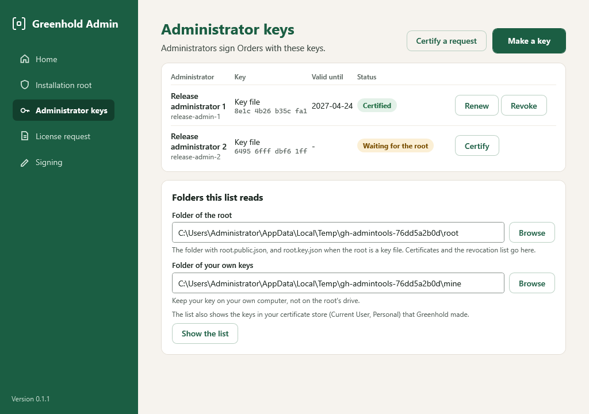
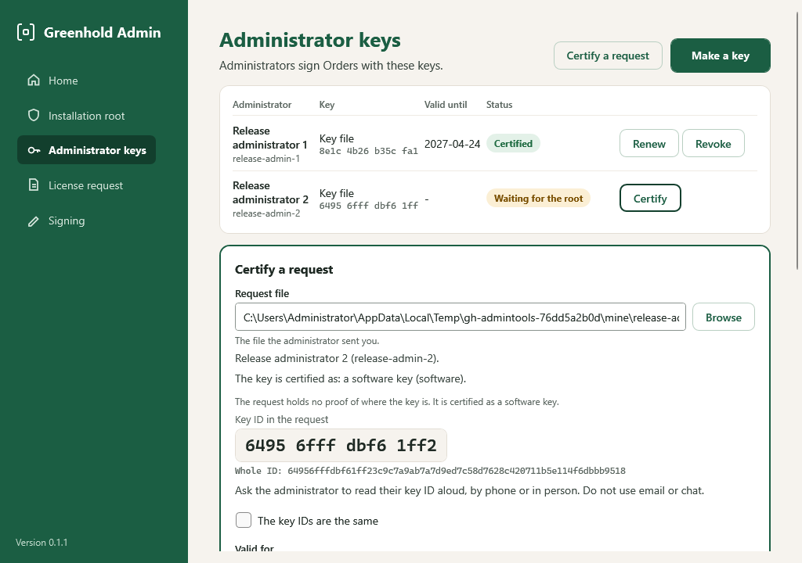

import { Tabs, TabItem } from '@astrojs/starlight/components';

An administrator signs Releases, Orders and publications with an **administrator key**.
The installation root certifies each key.
An agent runs only what a certified key signed.

## Where a key can live

| Place | Kind of key | Use |
|---|---|---|
| This computer's TPM | `windows-hello` | Recommended. The key is made in the TPM and cannot leave it. |
| A security key (PIV), such as a YubiKey | `security-key` | The key is made on the security key and cannot leave it. The security key asks for its own PIN. |
| A key file with a passphrase | `software` | For a test or a lab only. |

A key in the TPM or on a security key is a certificate in your certificate store (Current User, Personal), named *Greenhold administrator* and your ID.
The private key stays in the TPM or on the security key.

:::caution[Software keys]
By default, an agent accepts only hardware-backed keys.
It refuses an Order that a key file signed.
Use a key file only in a lab, and allow it in the agents' policy.
See [Strict defaults](/concepts/policy-for-agents/#strict-defaults).
:::

## Make a key

Do this on your own computer.

<Tabs syncKey="interface">
<TabItem label="GUI">

1. In Greenhold Admin, open **Administrator keys** and choose **Make a key**.
2. Type an **ID** that is a role, such as `release-admin-1`, and a **name**, such as `Release administrator 1`. Do not use the name of a person. Every signature keeps the ID and the name.
3. Choose where to keep the key:
   - **This computer's TPM**. Greenhold Admin chooses it when the computer has a TPM. With **Ask for my PIN when the key signs** ticked, Windows asks for a PIN when the key signs. Cleared, Windows asks nothing, and any program that you run can sign with the key.
   - **A security key**. Plug it in first.
   - **A key file with a passphrase**. Type the passphrase two times. You type it each time you sign.
4. Choose a folder on your own computer for the request. Do not use the drive of the root.



</TabItem>
<TabItem label="CLI">

```
greenhold-sign admin-create --admin-id release-admin-1 --name "Release administrator 1" --out <key folder> --store tpm
```

| `--store` | Place |
|---|---|
| `tpm` | This computer's TPM. |
| `smartcard` | A security key (PIV). |
| `software` | A key in your certificate store with no PIN. For tests only: nothing asks before it signs. |

Without `--store`, the command makes a key file with a passphrase.
To list the Greenhold keys in your certificate store:

```
greenhold-sign store-list
```

</TabItem>
</Tabs>

You get `<id>.request.json`.
For a TPM key or a security key, the request holds the **proof** of where the key is.
A key file also gives `<id>.key.json`, which stays with you.

The page shows your **key ID** in large type.
Send the request file to the root holder.
Then read your key ID aloud to the root holder, by phone or in person.
Do not use email or chat.

## Certify a key (the root holder)

Do this on the computer of the root holder, with the root.
Before you certify a TPM key, [protect the root's folder](#protect-the-roots-folder) and [trust the TPM](#trust-a-tpm).

<Tabs syncKey="interface">
<TabItem label="GUI">

1. In Greenhold Admin, open **Administrator keys**. Choose **Certify** on the key that waits, or choose **Certify a request** and select the request file.
2. The page shows the **key ID in the request** in large type. The administrator reads their key ID aloud. Compare the two.
3. Read the kind that the page shows. See [Proof of the kind](#proof-of-the-kind).
4. If the key IDs are the same, tick **The key IDs are the same**.
5. Choose how long the certificate is valid: 1 to 6 months.
6. For a root key file, type the passphrase of the root. For a root in the TPM or on a security key, Windows asks for its PIN.
7. Choose **Certify with the root**.



</TabItem>
<TabItem label="CLI">

With a root key file:

```
greenhold-sign admin-certify --root root.key.json --request <id>.request.json --out <id>.cert --months 6
```

With a root in the TPM or on a security key:

```
greenhold-sign admin-certify --cert-thumbprint <thumbprint of the root> --request <id>.request.json --out <id>.cert --months 6
```

`--attestation-roots <folder>` names the folder of trusted vendor roots.
The command shows the key ID in the request and the kind. Compare the key ID, then confirm.

</TabItem>
</Tabs>

The certificate is a `.cert` file with no secret in it.
For a TPM key, it is a `.sealed.json` file.
Send the file to the administrator.

### Proof of the kind

The root certifies the kind of key that the **proof** shows.
It never certifies a kind that the request only claims.

| The request holds | The key is certified as | What the root checks |
|---|---|---|
| No proof | `software` | Nothing more. A request that claims another kind without proof is refused. |
| A TPM's proof | `windows-hello` | The TPM's endorsement certificate is from a vendor you trust. The TPM made the key, and the key cannot leave the TPM. The certificate is sealed: only that TPM can open it. |
| A security key's proof | `security-key` | The attestation certificate of the security key is from a vendor you trust. It says that the key was made on the security key. The page shows its serial number. |

No proof shows whether a PIN is asked before each signature.
A proof that does not hold is refused, and nothing is certified.

### The attestation roots folder

The root checks a proof against the vendor certificates that **you** trust.
Put them in the folder `attestation-roots` in the root's folder, as `.cer`, `.crt`, `.der` or `.pem` files:

- `attestation-roots\tpm`: the roots of the TPM makers of your computers. Microsoft publishes them in its file *TrustedTpm.cab*.
- `attestation-roots\piv`: the PIV attestation root of the security key vendor, for example the *Yubico PIV Root CA*.

A file directly in `attestation-roots` is refused.

:::caution
Whoever can put a certificate in this folder decides which keys count as hardware.
The folders and files must be owned by Administrators, SYSTEM or you, and nobody else may change them.
No part of the path may be a junction or a link.
Otherwise every proof is refused.
A FAT32 USB drive has no permissions, so its folder is refused.
:::

### Protect the root's folder

The root's folder is the folder that holds `root.key.json`.
A folder directly under the root of a drive, such as `C:\GreenholdRoot`, gets its permissions from the drive.
These permissions include **Authenticated Users: Modify**.
Greenhold Admin refuses such a folder, and `greenhold-sign` refuses every proof in it.

Run this one time, in PowerShell as an administrator.
Change the path to the root's folder:

```powershell
icacls C:\GreenholdRoot /inheritance:r /grant:r "*S-1-5-32-544:(OI)(CI)F" "*S-1-5-18:(OI)(CI)F" "${env:USERDOMAIN}\${env:USERNAME}:(OI)(CI)F"
```

The command removes the permissions from the drive.
It gives full control to Administrators, SYSTEM and you.
Do the same for a folder on an NTFS USB drive.

### Trust a TPM

The root certifies a TPM key only when it can prove the TPM.
With no certificate in `attestation-roots\tpm`, the root refuses every TPM key.

Put the root certificate of your TPM vendor in `attestation-roots\tpm`.
Or trust one TPM: put that TPM's own endorsement certificate in `attestation-roots\tpm`.
Then that one TPM is trusted, and no other.

To export the endorsement certificate of this computer's TPM, run this in PowerShell as an administrator, on the computer with the TPM:

```powershell
New-Item -ItemType Directory C:\GreenholdRoot\attestation-roots\tpm -Force | Out-Null
$ek = (Get-TpmEndorsementKeyInfo).ManufacturerCertificates | Select-Object -First 1
[IO.File]::WriteAllBytes('C:\GreenholdRoot\attestation-roots\tpm\my-tpm.cer', $ek.RawData)
```

If `ManufacturerCertificates` is empty, the TPM has no endorsement certificate.
Then get the root certificate from the TPM vendor.

:::note[Virtual machines]
A virtual TPM in Hyper-V has no endorsement certificate.
The root refuses its keys: "The request holds no endorsement certificate of the TPM".
Test TPM keys on a physical computer, or use software keys in a lab.
:::

Before you certify, the page shows the vendor certificate that the proof was checked against: its name, its file and its SHA-256 fingerprint.
Compare the fingerprint with the vendor's.

## Unlock a TPM key's certificate (the administrator)

<Tabs syncKey="interface">
<TabItem label="GUI">

1. Put the `.sealed.json` file in your own keys folder.
2. In Greenhold Admin, open **Administrator keys**. The list shows the key as **Certificate to unlock**.
3. Choose **Unlock**. The TPM of the computer opens it and writes the `.cert` file beside it.

</TabItem>
<TabItem label="CLI">

```
greenhold-sign admin-unseal --sealed <id>.sealed.json --out <id>.cert
```

</TabItem>
</Tabs>

Another computer cannot open the file.

## Renew a key

The list shows the status of each key: **Waiting for the root**, **Certificate to unlock**, **Certified**, **Expires soon** (30 days or less), **Expired** or **Revoked**.

<Tabs syncKey="interface">
<TabItem label="GUI">

Choose **Renew** on the key.
The root certifies the same key again, so the key ID does not change.
Compare the key IDs again.

</TabItem>
<TabItem label="CLI">

Certify a new request of the same key with `admin-certify`, as above.

</TabItem>
</Tabs>

## Revoke a key

<Tabs syncKey="interface">
<TabItem label="GUI">

1. Choose **Revoke** on the key.
2. Tick **Revoke this key**.
3. Confirm with the root.

The root signs the next revocation list, `revocations.txt`, in the root's folder.
Each list holds all keys of the earlier lists.
The old list moves to `revocations.<n>.txt`.

</TabItem>
<TabItem label="CLI">

```
greenhold-sign revoke --root root.key.json --key-id <key id> --out revocations.txt --previous revocations.txt
```

For a root in the TPM or on a security key, use `--cert-thumbprint <thumbprint>` instead of `--root`.

</TabItem>
</Tabs>

:::note
In this version, Greenhold Admin does not send the revocation list to the agents.
:::

## Make a second administrator key

Some Orders need two signers, for example an Order for a server.
See [Second signer and tags](/dispatch/second-signer-and-tags/).
The second administrator makes a key on their own computer, with another ID, as above.
The root holder certifies it.

## Next

Read [Before you install](/get-started/before-you-install/).
