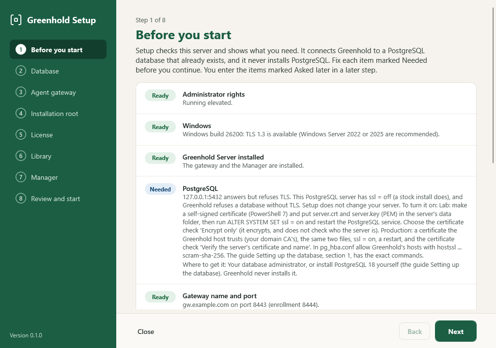
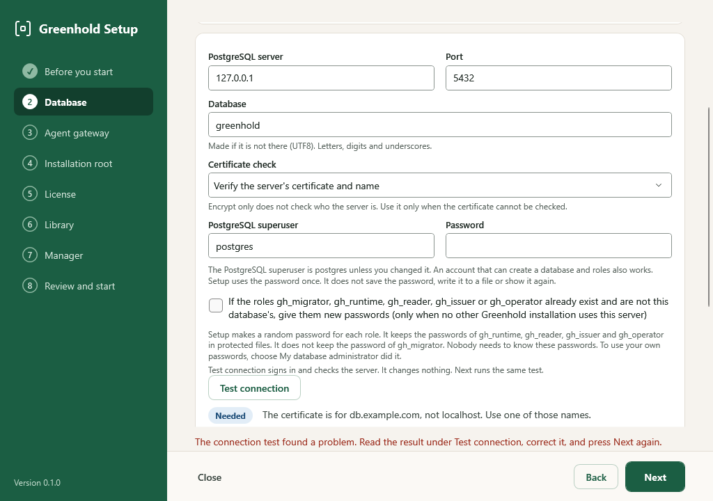
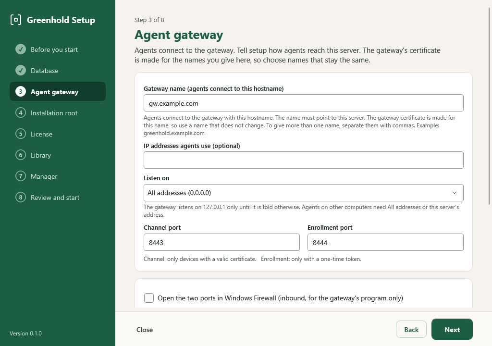
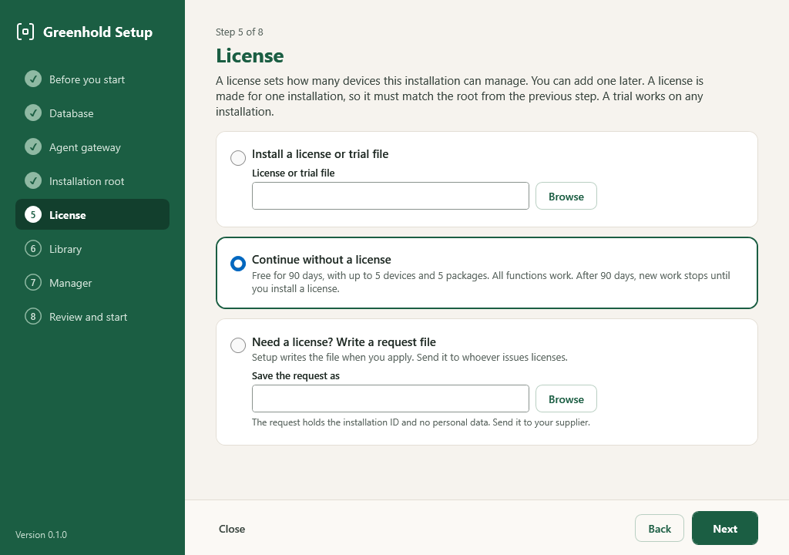
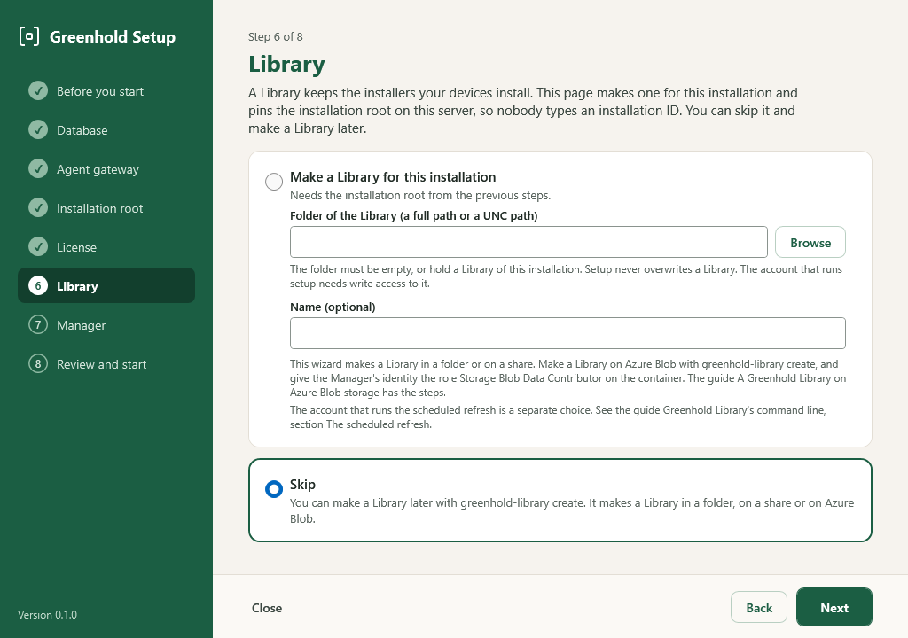
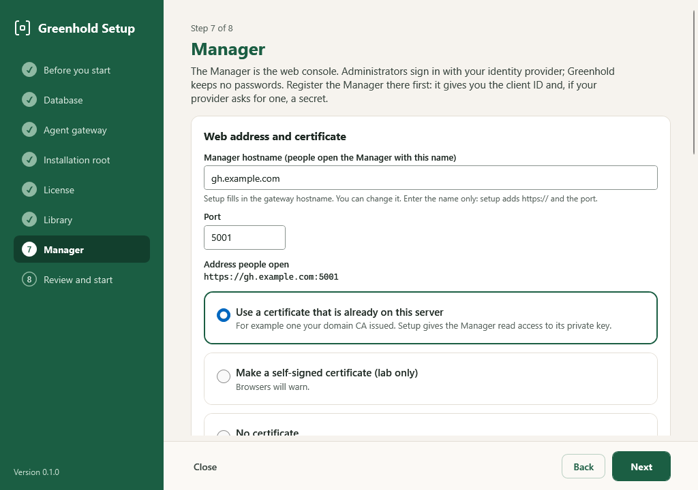
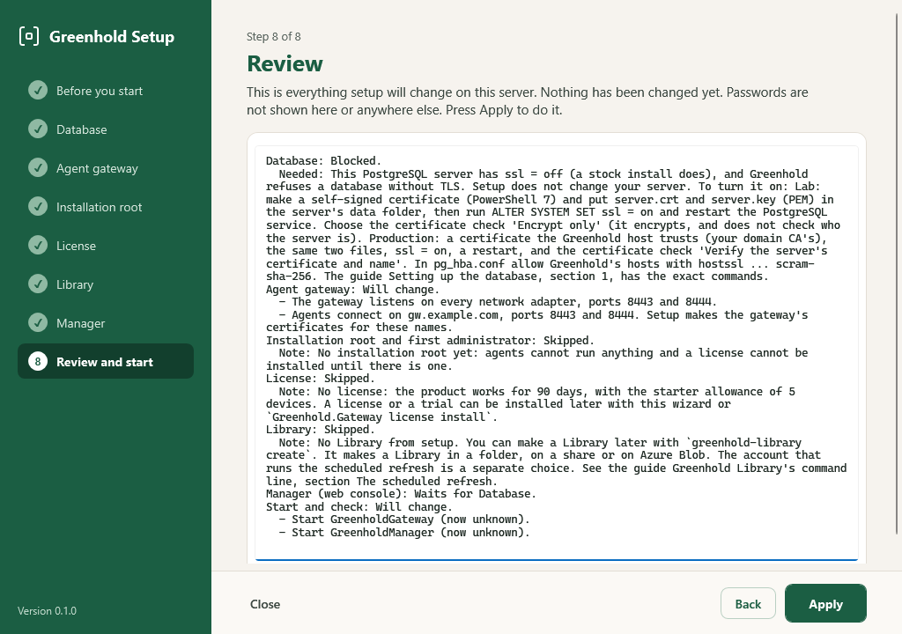
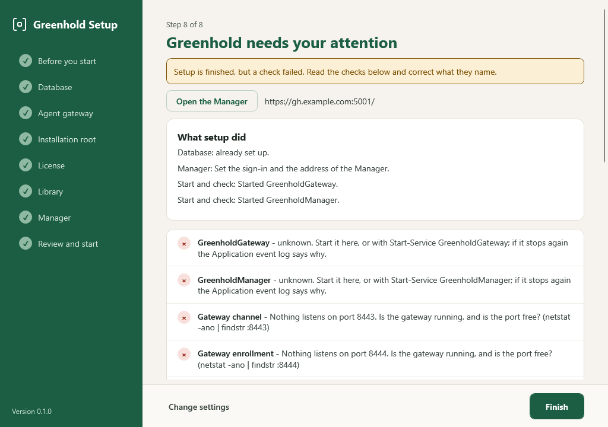

import { Tabs, TabItem } from '@astrojs/starlight/components';

You install the server in two moves.
First, the installer puts the programs on the computer.
Second, the setup wizard connects them.

The server installer installs these parts:

| Part | Service | Account |
|---|---|---|
| Gateway | `GreenholdGateway` | LocalSystem |
| Manager (web console) | `GreenholdManager` | `NT SERVICE\GreenholdManager` |
| Setup wizard | none | none |
| Library command line (`greenhold-library`) | none | none |
| Library refresh | `GreenholdLibraryRefresh` | `NT SERVICE\GreenholdLibraryRefresh` |
| Library automatic publisher | `GreenholdLibraryPublisher` | `NT SERVICE\GreenholdLibraryPublisher` |

## 1. Prepare PostgreSQL

Do this before you start the wizard.
Your database administrator can do it.

### Install PostgreSQL (quick way)

Skip this step when your database administrator already runs PostgreSQL 18.

:::caution
Production databases usually run on a separate server.
A database administrator runs that server.
Use this quick way for a test server or a small installation only.
:::

```powershell
winget install --id PostgreSQL.PostgreSQL.18 -e --interactive
```

The installer asks you to set the password of the `postgres` superuser.
Type the password in the installer window.
Do not type it on a command line.

After the install:

- The service name is `postgresql-x64-18`. Check it in `services.msc`.
- `psql.exe` is in `C:\Program Files\PostgreSQL\18\bin`. Add this folder to the path for the session:

  ```powershell
  $env:Path += ';C:\Program Files\PostgreSQL\18\bin'
  ```

- A new PostgreSQL has TLS off, and Greenhold refuses it. Turn on TLS as the next section shows.
- The `psql` commands ask for the `postgres` password. Type it at the prompt.

### Turn on TLS

Find the data folder of PostgreSQL:

```
psql -U postgres -c "SHOW data_directory;"
```

In production, use a certificate that the Greenhold server trusts.
Your own certificate authority can issue it.
Put the certificate and its key in the data folder as `server.crt` and `server.key`.
Only the PostgreSQL service account can read the key file.
The name in the certificate must be the name that Greenhold uses to connect.

For a test environment, make a self-signed certificate.
Run this in PowerShell 7 as an administrator.
Set `$data` to the data folder:

```powershell
$name = 'db.example.com'
$key = [Security.Cryptography.RSA]::Create(3072)
$request = [Security.Cryptography.X509Certificates.CertificateRequest]::new("CN=$name", $key, 'SHA256', 'Pkcs1')
$san = [Security.Cryptography.X509Certificates.SubjectAlternativeNameBuilder]::new()
$san.AddDnsName($name)
$request.CertificateExtensions.Add($san.Build())
$certificate = $request.CreateSelfSigned([DateTimeOffset]::UtcNow.AddDays(-1), [DateTimeOffset]::UtcNow.AddYears(1))
Set-Content -LiteralPath "$data\server.crt" -Value $certificate.ExportCertificatePem() -Encoding ascii
Set-Content -LiteralPath "$data\server.key" -Value $key.ExportPkcs8PrivateKeyPem() -Encoding ascii
```

Then turn on TLS and restart PostgreSQL:

```
psql -U postgres -c "ALTER SYSTEM SET ssl = on"
Restart-Service postgresql-x64-18
psql -U postgres -c "SHOW ssl"
```

The last command must show `on`.
The name of the service is in `services.msc`.

In `pg_hba.conf`, allow the Greenhold hosts with `hostssl ... scram-sha-256` only.
Then reload PostgreSQL.

### Choose the TLS check

| Mode | Use |
|---|---|
| `VerifyFull` | Production. It checks the certificate and the name. |
| `Require` | Test environments only. It encrypts. It does not check who the server is. |

Greenhold refuses the modes `Disable`, `Allow` and `Prefer`.

:::caution
Greenhold accepts only SCRAM authentication.
A server that asks for a clear-text password never receives one.
:::

## 2. Prepare the identity provider

The Manager uses OpenID Connect for sign-in.
These steps are for Microsoft Entra ID.

1. In the Entra admin center, select **App registrations**, then **New registration**.
2. Select the platform **Web**.
3. Set the redirect URI to `https://<manager hostname>:<port>/signin-oidc`. The Manager page of the setup wizard shows this address with a **Copy** button.
4. Copy the **Directory (tenant) ID** and the **Application (client) ID**.
5. Give only the tenant ID to the setup wizard. The wizard makes the issuer address from it.
6. Select **Certificates & secrets**, then **New client secret**. Copy the value at once. Also write down the date in the **Expires** column.
7. Select **Token configuration**, then **Add groups claim**, then **Security groups**. Add it to the ID token.
8. Make a security group for the Greenhold administrators. Copy its object ID.

Entra sends group IDs, not names.
Members of this group are Administrators in the Manager.
Other people who sign in see the page "No access".

:::note
The client secret expires.
After the date, nobody can sign in.
Make a new secret before the date.
:::

### The expiry date of the secret

The Manager cannot ask Entra when the secret expires.
Give the date to the Manager, and it warns you before the date.

- In the setup wizard, type the date in **Secret expires (yyyy-MM-dd)** on the Manager page.
- Or set `Manager:Identity:ClientSecretExpires` in `%ProgramData%\Greenhold\Manager.appsettings.json`, for example `"2027-10-23"`. Restart `GreenholdManager`.

The status page of the Manager has the card **Sign-in secret**:

| State | When |
|---|---|
| Valid | More than 30 days before the date. |
| Expires soon (warning) | From 30 days before the date. |
| Expires very soon (error) | From 7 days before the date. |
| Expired (error) | On the date and after it. A secret expires at a time on its date. |
| No date (note) | The Manager has a secret, but no date. |
| Not a date (warning) | The setting is not in the format `yyyy-MM-dd`. |

The Manager counts the days in UTC.
It also writes a security event to its event log (Event Viewer: Applications and Services Logs > Greenhold > Manager): 5501 from 30 days before the date, 5502 from 7 days before the date, and 5503 from the date itself.
It writes each event at most once a day.
See [Logs and support bundles](/operate/logs-and-support-bundles/).

When you make a new secret, also change the date.
See [The client secret expired](/operate/troubleshooting/#the-client-secret-expired).

## 3. Get the Manager certificate

Import a certificate with its private key into **Local Computer > Personal**.
Browsers must trust it.
Your own certificate authority can issue it.
See [Certificates](/concepts/certificates/).

The Manager account must read the private key.
To grant it:

1. Run `certlm.msc`.
2. Right-click the certificate.
3. Select **All Tasks > Manage Private Keys > Add**.
4. Add `NT SERVICE\GreenholdManager` with **Read**.

The setup wizard grants this access for you.

For a test environment only, the wizard can make a self-signed certificate.
Browsers do not trust it.

## 4. Run the installer

Check the files first.
`SHA256SUMS.txt` lists every file of the release:

```powershell
Get-FileHash .\Greenhold-Server-<version>-x64.msi
Get-AuthenticodeSignature .\Greenhold-Server-<version>-x64.msi
```

Double-click `Greenhold-Server-<version>-x64.msi`.
Read the license agreement.
Accept it to continue.
The last dialog offers to start the setup wizard.
Later, start it from the Start menu: **Greenhold Server Setup**.

For a silent install, run this as an administrator:

```
msiexec /i C:\path\Greenhold-Server-<version>-x64.msi /qn /norestart LICENSEACCEPTED=1 /l*v C:\Windows\Temp\greenhold-server.log
```

Use the full path to the MSI.
For the other properties and the exit codes, see [Installer properties](/reference/installer-properties/).

The installer does these things:

- It starts no service. The services need setup first.
- It adds the services and their accounts. The two Library services exist only after the server installer of version 0.1.4 or later.
- It opens no firewall port.
- It makes no certificate and no database.

## 5. Run the setup wizard

The setup wizard connects the parts.
You can run it again at any time.
It shows what is done and changes only what you change.

<Tabs syncKey="interface">
<TabItem label="GUI">

Start **Greenhold Server Setup** from the Start menu.

1. **Before you start.** The wizard checks this server. Each line says **Ready**, **Note**, **Optional**, **Asked later** or **Needed**.
   - **Needed** is something to arrange outside the wizard before you continue.
   - **Asked later** is something that a later page asks for, such as the gateway name, the identity provider, the Manager certificate and the installation root. Have it ready. There is nothing to do yet.

   The wizard looks for PostgreSQL on this server. When it finds one, it fills in the server name and the port on the **Database** page and checks TLS. When it finds nothing, it shows a `winget` command to install PostgreSQL for a lab.

   

2. **Database.** Choose **Set it up for me** and give the **PostgreSQL superuser** (`postgres` by default) and its password. Or choose **My database administrator did it** and give a file with the connection string of each role: `gh_migrator`, `gh_runtime`, `gh_reader`, `gh_issuer` and, optionally, `gh_operator`. Choose **Test connection**. The test signs in and checks TLS, `scram-sha-256`, the version and the right to make a database and roles. It changes nothing. **Next** runs the same test.

   When the server's certificate is refused, the page says why in one sentence:

   | The page says | What to do |
   |---|---|
   | The certificate is for *name*, not *other name*. Use one of those names. | Use a name that the page lists. |
   | This server does not trust the certificate of the PostgreSQL server. | Import the certificate of the issuing CA into Trusted Root Certification Authorities on this server. Or, in a lab, use **Encrypt only**. |
   | The certificate of the PostgreSQL server expired on *date*. | Renew the certificate on the PostgreSQL server. |
   | The TLS connection to the PostgreSQL server failed. | Check the certificate and the log of the PostgreSQL server. |

   

   The wizard makes the database and the roles. It makes a random password for each role and keeps it in a protected file. Nobody needs to know these passwords.

3. **Agent gateway.** **Gateway name (agents connect to this hostname)** is filled in with the DNS name of this server. Change it if agents use another name. Choose **Listen on**, the ports, and whether to open the two ports in Windows Firewall. See [Bind addresses](#bind-addresses).

   

4. **Installation root.** Choose **Import a root made on an admin computer** and give `root.public.json`. Do not give `root.key.json`. See [The Installation root page](#the-installation-root-page).
5. **License.** Choose **Install a license or trial file**, **Continue without a license**, or **Need a license? Write a request file**. When you choose a file, the page checks it at once. A valid file shows one line, for example "Valid for this installation. 25 devices. Dispatch and Library." A file that is not valid shows why, and **Save license request** writes a request file for your supplier.

   

6. **Library.** Optional. Choose **Make a Library for this installation** and give a folder or a share. The wizard makes the library, pins the root, connects the library to the Manager, gives it to the refresh service and sets up automatic publishing. See [Create a library](/library/create-a-library/).

   

7. **Manager.** Fill in the page from the top:
   - **Manager hostname (people open the Manager with this name)**. The wizard fills in the gateway name. Give the name only: the wizard adds `https://` and the port. **Port** is 5443 by default. The page shows the full address.
   - The certificate: **Use a certificate that is already on this server**, or **Make a self-signed certificate (lab only)**.
   - Sign-in. For **Microsoft Entra ID**, type the **Tenant ID**: a GUID or a verified domain. The wizard makes the issuer address and shows it. Type the client ID, the client secret, and the **Object ID** of the administrators' group. For another OpenID Connect provider, give its full issuer address and the group value.
   - The redirect address for the app registration, with a **Copy** button.
   - The date that the client secret expires. The page refuses a date that is today or earlier.

   

8. **Review and start.** The review lists every change in plain words. Nothing changes before you choose **Apply**. A step can say **Will change**, **Already set up**, **Skipped**, **Waits for** *step* or **Blocked**. "Waits for" is not a problem: the step runs after the step that it waits for.

   

When you choose **Apply**, a progress bar shows each step.
At the end, a banner shows the result:

| Banner | Meaning |
|---|---|
| Green: "Setup is finished. Greenhold is running." | Every step is done and every check passed. |
| Amber | Setup is finished, but a check failed. Read the checks and correct what they name. |
| Red | A step failed. The banner names the step and what to do. **Back** and **Apply** work again. Steps that are done stay done. |



Each banner ends with the path of the setup log.
The page has **Open the Manager** with its address, and the next step: enroll your first device.

After the wizard, open the Manager and sign in one time.
This proves that the identity provider works.

:::caution[Version 0.1.4: start the Library services]
In version 0.1.4, setup does not start the two Library services.
If you made a library, start them after setup.
Run this in PowerShell as an administrator:

```powershell
Start-Service GreenholdLibraryRefresh, GreenholdLibraryPublisher
```

Until they run, the library does not refresh and does not publish automatically.
A later version starts them for you.
If `Start-Service` cannot find a service, run the server installer of version 0.1.4 and setup first.
:::

Then protect the library folder.
See [Protect the library folder](/library/create-a-library/#protect-the-library-folder).

</TabItem>
<TabItem label="CLI">

Run the same steps without a window, in an elevated prompt:

```
Greenhold.Setup.exe --answers C:\path\answers.json --plan
Greenhold.Setup.exe --answers C:\path\answers.json
```

`--plan` shows what would change and changes nothing.
The answers file holds names, addresses and paths, and **never a secret**.
A password or a passphrase comes from a file (`AdminPasswordFile`, `RootPassphraseFile`, `AdminPassphraseFile`, `ClientSecretFile`) or from an environment variable.
Each such file must be readable only by you, Administrators and SYSTEM.

```json
{
  "Database": { "Host": "db.example.com", "DatabaseName": "greenhold", "AdminUser": "postgres", "AdminPasswordFile": "C:\\secure\\pg-admin.txt" },
  "Gateway": { "Dns": [ "gateway.example.com" ], "AcceptLicense": true, "OpenFirewall": false },
  "Root": { "Mode": "Import", "RootPublicFile": "C:\\secure\\root.public.json" },
  "License": { "Mode": "Skip" },
  "Library": { "Mode": "Create", "Path": "D:\\Library", "Name": "Library" },
  "Manager": {
    "Url": "https://greenhold.example.com:5443", "Authority": "https://login.microsoftonline.com/<tenant>/v2.0", "ClientId": "<client id>",
    "ClientSecretFile": "C:\\secure\\client-secret.txt", "ClientSecretExpires": "2027-10-24", "AdminGroup": "<group id>",
    "CertificateMode": "Store", "CertificateSubject": "CN=greenhold.example.com"
  }
}
```

Exit codes: 0 done, 1 refused or failed (the text says why), 2 a wrong command line, 3 not elevated.
After a finished run, the command prints the checks and writes the agent installer's command line to `%ProgramData%\Greenhold\Setup\Install-GreenholdAgent.cmd`.
The log is `%ProgramData%\Greenhold\Setup\setup.log`.

:::caution[Version 0.1.4: start the Library services]
In version 0.1.4, setup does not start the two Library services.
If the answers file makes a library, start them after setup:

```powershell
Start-Service GreenholdLibraryRefresh, GreenholdLibraryPublisher
Get-Service GreenholdLibraryRefresh, GreenholdLibraryPublisher
```

Both services must show `Running`.
A later version starts them for you.
If `Start-Service` cannot find a service, run the server installer of version 0.1.4 and setup first.
:::

Then protect the library folder.
See [Protect the library folder](/library/create-a-library/#protect-the-library-folder).

</TabItem>
</Tabs>

:::caution
The wizard can make the root on the server for a small environment.
Then anyone who takes over the server can sign Orders until the private keys leave it.
Prefer to make the root on your own computer with Greenhold Admin.
:::

### The Installation root page

| Choice | Use |
|---|---|
| **Import a root made on an admin computer** | Recommended. Choose `root.public.json`. The page shows the installation ID and the key ID of the file. Compare them with the root holder. |
| **Make the root on this server** | For a lab or a small installation. The wizard makes the root and the first administrator key. |
| **Later** | Agents run nothing until there is a root. |

If you choose **Make the root on this server**, give these items:

- The ID and the name of the first administrator. Use a role, not the name of a person.
- A passphrase for the root and a passphrase for the administrator key. Each has at least 10 characters.
- A folder on removable media, such as a USB drive.

The wizard copies the private keys to the removable media, checks the copies and deletes the keys from the server.
Keep the media offline.
The key that the wizard makes is a software key.
The agents accept it only when their policy allows software keys.

If you have a license, import the root that the license is for.
A license works only for its installation ID.

The wizard keeps the public file on the server in this place:

```
C:\ProgramData\Greenhold\Gateway\root.public.json
```

### Bind addresses

The gateway listens on `127.0.0.1` until you say otherwise.
Agents on other computers cannot connect to it.

| Setting | Value |
|---|---|
| Listen address | `0.0.0.0` for all adapters, or the address of this server |
| Channel port | 8443 |
| Enrollment port | 8444 |

The wizard writes these settings and restarts the gateway.
Check the result:

```powershell
Get-NetTCPConnection -State Listen -LocalPort 8443,8444
```

If the address is `127.0.0.1`, agents on other computers cannot connect.

The name that agents use must resolve to this server.
Test it from an agent computer:

```powershell
Test-NetConnection <name> -Port 8443
Test-NetConnection <name> -Port 8444
```

Both must show `TcpTestSucceeded : True`.

### Firewall and NAT

The installer opens no port.
You decide whether the wizard adds a rule.
The rule admits only the gateway program on ports 8443 and 8444.
Limit it to the subnets of your agents.

To add the rule yourself:

```powershell
New-NetFirewallRule -DisplayName 'Greenhold Agent Gateway' -Direction Inbound -Action Allow -Protocol TCP -LocalPort 8443,8444 -Program 'C:\Program Files\Greenhold\Gateway\Greenhold.Gateway.exe' -RemoteAddress <agent subnets>
```

:::note
An agent behind NAT arrives with the address of the NAT router.
Put the router address in the rule.
Do not put the agent subnet in the rule.
:::

Offer only port 8443 to the internet.
Keep port 8444 on the internal network.
Open it only while you enroll devices.
Never offer the Manager to the internet.

### Where the settings of this computer are

| Program | File |
|---|---|
| Gateway | `%ProgramData%\Greenhold\Gateway\appsettings.json` |
| Manager | `%ProgramData%\Greenhold\Manager.appsettings.json` |

An upgrade or an uninstall removes the `appsettings.json` beside the programs.
It never touches these two files.
Restart a service after you change its settings.

## Next

Read [Enroll your first device](/get-started/enroll-your-first-device/).
