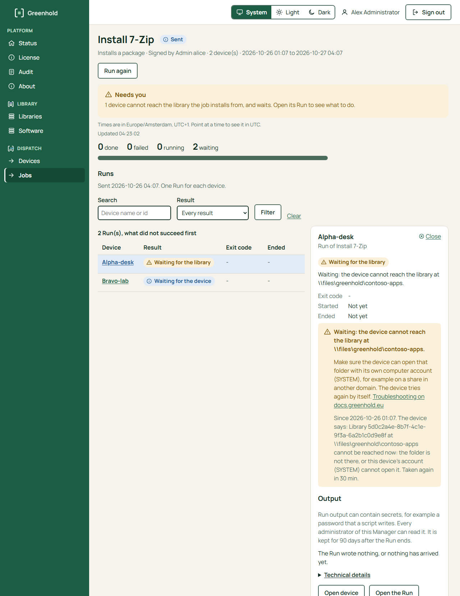

import { Tabs, TabItem } from '@astrojs/starlight/components';

Dispatch installs a package with an `InstallPackage` Action in a signed Release.
The Action names a package.
It never names a location.

## Before you start

- A library with a signed publication. See [Create a library and add a package](/library/create-a-library/).
- An enrolled device. See [Enroll your first device](/get-started/enroll-your-first-device/).
- Greenhold Admin and a certified administrator key. See [Sign with Greenhold Admin](/manager/sign-with-greenhold-admin/).

The gateway delivers the library files to the agent.
The agent reads no folder or share itself.
The gateway reads the library from a folder, a share or an Azure Blob container.

## 1. Tell the gateway where the library is

Setup does this for a library that it makes.
It writes the library into the settings of the gateway, in the section `Gateway:LibraryDelivery`.
Do the step yourself for a library on Azure Blob or on another server.
Do it on every gateway node.

1. Find the library ID in `library.json` in the library folder, as the value of `libraryId`:

   ```powershell
   (Get-Content -Raw \files\library\library.json | ConvertFrom-Json).libraryId
   ```

2. Open `%ProgramData%\Greenhold\Gateway\appsettings.json` on the gateway computer. In `Gateway:LibraryDelivery`, add an entry to `Libraries`:

   ```json
   "LibraryDelivery": {
     "Libraries": [
       { "Id": "<library id>", "Location": "\\files\library" }
     ]
   }
   ```

   For a library on Azure Blob, also give the identity of the gateway. See [Azure Blob libraries](/library/azure-blob/#the-gateway-delivery-to-devices).

3. Give the gateway read access to the library. The gateway runs as `LocalSystem`. A local folder needs no extra permission. For a share, give the computer account of the gateway computer read access.
4. Restart the gateway: `Restart-Service GreenholdGateway`.

The gateway reads the library again every 5 minutes, and at once when a device asks for a new publication.
It copies an installer into its cache when a device asks for it first.
The agent checks every file against the signed publication.
An agent needs no setting for the library.

## 2. Make the job

<Tabs syncKey="interface">
<TabItem label="GUI">

1. In the Manager, open **Jobs** and choose **New job**.
2. **Name**: type a **Name of the job**, for example `Install 7-Zip`. Choose **Next**.
3. **What**: choose **Installs a package from a library**. Choose the **Package**.
4. Choose the **Version**. Choose one version, for example the active one, to install that installer and its steps, and nothing else. This is the pinned form. **Latest** follows the library: a newer publication, also an automatic one, is installed when the job runs.
5. **Where**: choose the devices.
6. **When**: set the **Start** and the **End**, in the time zone of your browser.
7. **Review and sign**: check each row. Choose **Make the job and sign with Greenhold Admin**.
8. Sign the job with Greenhold Admin. Greenhold Admin shows the package and the version. See [Sign with Greenhold Admin](/manager/sign-with-greenhold-admin/).

The job page shows the library by its name. The library's ID is under **Technical details**.

The Manager sends the job when it carries every signature that it needs.

</TabItem>
<TabItem label="CLI">

Write the content of the Action:

```
greenhold-sign install-spec --library <library folder> --library-id <id> --root root.public.json --package 7zip.7zip --out install.json
```

The command reads the verified publication of the library.
It prints the plan: every package it installs, with version, installer and switches.
Read the plan before you sign.
It also prints the SHA-256 of `install.json`.

Add `--refuse-automatic` to make the Action refuse automatic publications.

Sign the Release and the Order:

Write a Release draft with an Action of this form:

```json
{ "id": "a1", "type": "InstallPackage", "hash": "<sha256 that install-spec printed>", "artifacts": [] }
```

A Release with only this Action has `"parameters": []`.
Its Order has `"values": {}`.

Sign the Release and the Order as in [Run a PowerShell script on a device](/dispatch/run-a-powershell-script/).
Use a new `jobId` and a new `orderId`, for example `install-7zip` and `install-7zip-1`.
If the device is a server, the Order needs two signers.

Store the Order:

Copy the signed files and `install.json` to the gateway computer.
Run this in an elevated PowerShell there:

```powershell
& 'C:\Program Files\Greenhold\Gateway\Greenhold.Gateway.exe' order add --release release.signed --order order.signed --content install.json
```

</TabItem>
</Tabs>

The Action has one of two forms:

| Form | In the Manager | On the command line | What the agent installs |
|---|---|---|---|
| Pinned | **Version**: one version | Default, or `--version <v>` | The version, the installer and the whole plan that the Action names. The agent refuses a later publication that changes any item of the plan. |
| Published | **Version**: **Latest** | `--follow-publication` | Whatever the verified publication names when the job runs, also a publication of the automatic publisher. |

:::caution
The published form lets a later publication change what runs.
Use the pinned form for sensitive computers.
:::

## 3. Read the result

<Tabs syncKey="interface">
<TabItem label="GUI">

In the Manager, open **Jobs** and choose the job.
Choose the Run of a device to see its state, its exit code and its output.

A Run that worked shows **Succeeded**.
The output shows the pinned version, `SHA-256 verified` and `installed (exit 0)`.



A Run that shows **Waiting for the library** waits because the device cannot get the library files from the gateway now.
The Run says "Waiting: the device cannot get the library's files from the gateway now.", what to do, and since when.
See [Troubleshooting](/operate/troubleshooting/#a-job-waits-for-the-library).

</TabItem>
<TabItem label="CLI">

Wait a few minutes. Then run:

```powershell
& 'C:\Program Files\Greenhold\Gateway\Greenhold.Gateway.exe' run list
& 'C:\Program Files\Greenhold\Gateway\Greenhold.Gateway.exe' run output install-7zip-1
```

A Run that worked shows `succeeded`.
The output shows the pinned version, `SHA-256 verified` and `installed (exit 0)`.

</TabItem>
</Tabs>

If a Run is refused with code 50, the gateway does not deliver the library.
Do [step 1](#1-tell-the-gateway-where-the-library-is) again and restart the gateway service.

## What the agent does

Before it claims the Order, the agent does these steps:

1. It reads the publication and verifies it against its root.
2. It plans the package and its dependencies.
3. It copies each installer and script to the folder of the Run.
4. It holds each copy open and checks its hash.

Then it runs the held copies.
An MSI runs through `msiexec /norestart`.

The agent refuses a package whose switches force a restart.
The agent never restarts the computer.
When a package asks for a restart, the Run ends with the code 3010 or 1641.

When the library is not reachable, the Order waits.
The wait starts at 1 minute and doubles up to 30 minutes.
Each time, the agent tells the gateway why: the Manager shows **Waiting for the library**.

When an installer fails, the Run's output shows part of its log.
For an MSI, these are the lines around the action that failed and each error line, for example `Error 1303`.
For other installers, it is the end of the log.
The agent keeps the logs of a failed Run for 14 days, in `%ProgramData%\Greenhold\Agent\run-logs`.
The Run says in which folder.
The policy values `FailedRunLogDays` and `FailedRunLogCount` change how long and how many. See [Policy for agents](/concepts/policy-for-agents/).

If the gateway does not deliver the library, the agent refuses the Order with code 50.
See [Orders and Releases](/dispatch/orders-and-releases/#what-the-agent-checks) for the codes.

## Next

- [Remove a package from a device](/library/remove-a-package/)
