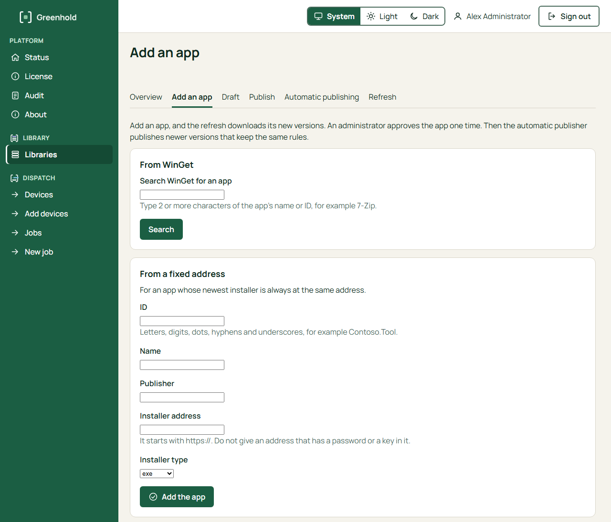
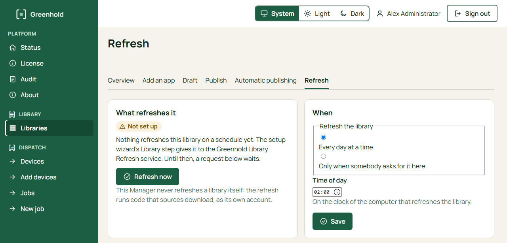
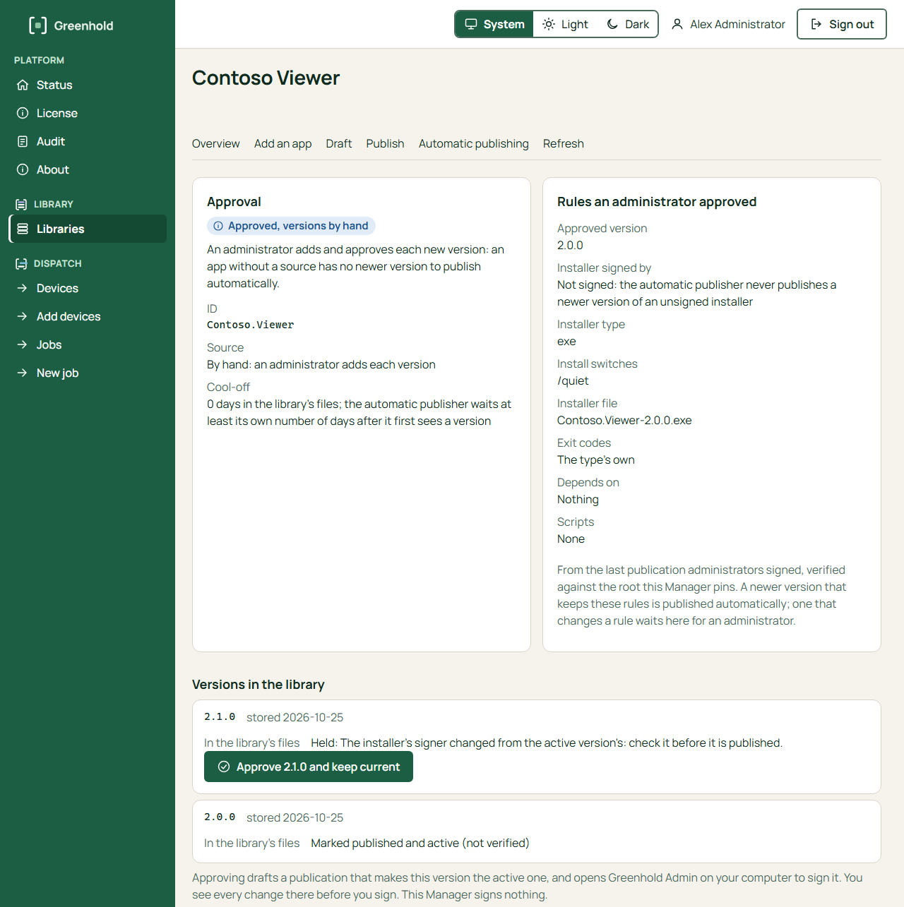
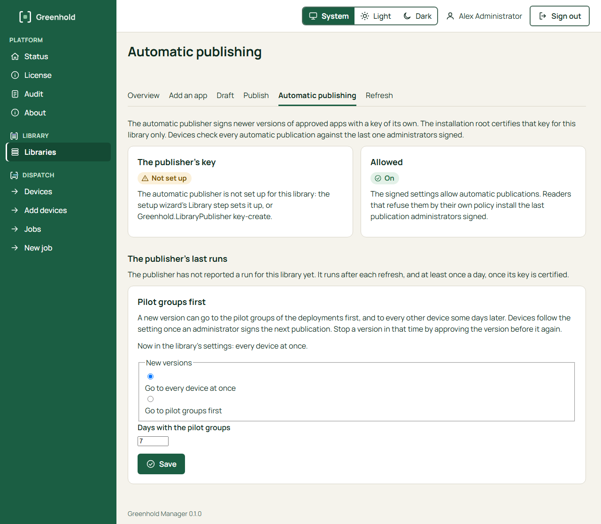

import { Tabs, TabItem } from '@astrojs/starlight/components';

Greenhold Library finds, downloads, checks and publishes new versions of your apps.
An administrator approves an app **one time**.
After that, the **automatic publisher** publishes newer versions that keep the same rules.
A version that changes a rule waits for an administrator.

The Manager starts and shows every step.
It never downloads an installer and never runs a source itself.
Two Windows services on the Greenhold server do that work:

| Service | Account | Job |
|---|---|---|
| Greenhold Library Refresh | `NT SERVICE\GreenholdLibraryRefresh` | Checks the sources and stores new versions as candidates. |
| Greenhold Library Publisher | `NT SERVICE\GreenholdLibraryPublisher` | Publishes newer versions of approved apps with its own key. |

The two services use different accounts.
The refresh runs code that sources download, so it can never use the publisher's key.

The setup wizard's **Library** step sets up both services for the library it makes.
See [Create a library](/library/create-a-library/).

In the Manager, open **Libraries** and choose the library.
The library has these pages: **Overview**, **Add an app**, **Draft**, **Publish**, **Automatic publishing** and **Refresh**.

## Add an app

<Tabs syncKey="interface">
<TabItem label="GUI">

You must be an Administrator in the Manager.

1. Open the library's page **Add an app**.
2. Choose one source:
   - **From WinGet**. Type 2 or more characters of the app's name or ID in **Search WinGet for an app**, and choose **Search**. Choose the app and its installer.
   - **From a fixed address**. For an app whose newest installer is always at the same address. Type the **ID**, the **Name**, the **Publisher** and the **Installer address**. The address starts with `https://`. Do not give an address that has a password or a key in it. Choose the **Installer type**.
   - **By hand**. For an app that has no source. Type the **ID**, the **Name** and the **Publisher**.
3. Choose **Add the app**.



To add a version by hand, open the app's page.
Under **Add a version by hand**, type the **Version**, choose the **Installer file** (at most 4 GiB), the **Installer type**, the **Switches for a silent install** and the **Architecture**.
Choose **Add the version**.
A version that you add by hand is never published automatically: approve it on the app's page.

</TabItem>
<TabItem label="CLI">

```
greenhold-library add-package --library <lib> --package 7zip.7zip --name "7-Zip" --winget --installer-type wix
greenhold-library add-package --library <lib> --package Contoso.Tool --name "Tool" --url https://downloads.example.com/tool.msi --installer-type msi
greenhold-library add-package --library <lib> --package Contoso.Internal --name "Internal tool"
greenhold-library add-version --library <lib> --package Contoso.Internal --version 1.2.0 --file tool.exe --installer-type exe --silent "/quiet"
```

See [Create a library](/library/create-a-library/#3-add-a-package).

</TabItem>
</Tabs>

## Refresh now, or on a schedule

A refresh checks every source, stores new versions as candidates and checks the signature of each installer.
It writes a draft.
A refresh never publishes.

<Tabs syncKey="interface">
<TabItem label="GUI">

1. Open the library's page **Refresh**.
2. To refresh at once, choose **Refresh now**. The refresh service starts the refresh within 5 minutes. A scheduled task starts it within 15 minutes. A refresh that somebody asks for starts at the earliest one hour after the last refresh started. A refresh that you ask for checks every package again.
3. Under **When**, choose one:
   - **Every day at a time**. Set the **Time of day**. The time is on the clock of the computer that refreshes the library. The default is 02:00.
   - **Only when somebody asks for it here**.
4. Choose **Save**.



The page also shows the last refresh: the run, its draft, and what happened to each package.

</TabItem>
<TabItem label="CLI">

Refresh at once:

```
greenhold-library refresh --library <lib>
```

Give the library to the refresh service, daily at 02:00, in an elevated prompt:

```
greenhold-library schedule --library <lib> --service --at 02:00
```

Or use a scheduled task with an account that you choose, such as a group managed service account:

```
greenhold-library schedule --library <lib> --at 02:00 --account <account>
```

`schedule --show` shows what is set up. `schedule --remove` removes it.

</TabItem>
</Tabs>

## Approve an app and keep it current

The app's page shows the rules that the last publication of administrators fixed:
the signer of the installer, the installer type, the switches, the exit codes, the dependencies and the scripts.
It also shows each stored version, with the reason when a version waits.

<Tabs syncKey="interface">
<TabItem label="GUI">

1. Open the library's page **Overview** and choose the app.
2. Under **Versions in the library**, read the version and why it waits.
3. Choose **Approve** *version* **and keep current**. The Manager drafts a publication that makes this version the active one.
4. Sign it with Greenhold Admin. You see every change before you sign. See [Sign with Greenhold Admin](/manager/sign-with-greenhold-admin/).



</TabItem>
<TabItem label="CLI">

```
greenhold-library draft --library <lib> --ready
greenhold-sign sign --kind publication --draft <lib>\publication\draft.json --content <lib>\publication\content\<sha256>.json --library <lib> --root root.public.json --state <your folder> --admin-key admin.key.json --cert admin.cert --out publication.signed
greenhold-library publish --library <lib> --file publication.signed
```

See [Create a library](/library/create-a-library/#5-draft).

</TabItem>
</Tabs>

After the approval, the automatic publisher publishes newer versions of the app that keep the same rules.
A version that changes a rule shows **Held** on the app's page and waits for an administrator.
For example: the signer of the installer changed.

## Automatic publishing

Automatic publishing is **on by default** for a library that the setup wizard makes.
The wizard makes the publisher's key on the server.
The key works only after the root holder certifies it.
Until then, nothing is published automatically.

The automatic publisher never does these things:

- It never makes the first publication.
- It never adds or removes an app.
- It never changes a rule of an app.
- It never publishes an unsigned installer.

It waits a **cool-off** time after it first sees a version: 3 days by default.
An automatic publication is valid for 30 days.
An administrator must publish at least one time in each period.

### Certify the publisher's key (the root holder)

<Tabs syncKey="interface">
<TabItem label="GUI">

1. Open the library's page **Automatic publishing**. **The publisher's key** shows its state.
2. Choose **Certify the key with Greenhold Admin**.
3. In Greenhold Admin, read what you certify. In **Key id from the setup wizard**, type the first 16 characters of the key ID that the setup wizard showed on the server. The wizard shows them in four groups of four, for example `0123 4567 89ab cdef`. Spaces do not matter. Get them from the server by voice or in person. Do not copy them from the Manager or from Greenhold Admin. On the server, `Greenhold.LibraryPublisher.exe show` shows them again.
4. Choose **Sign with the root and send to the Manager**. Greenhold Admin signs only when the characters that you typed are the same as the key ID in the request.

The Manager checks the certificate against the root and stores it in the library.
The publisher then runs after each refresh, and at least one time each day.



</TabItem>
<TabItem label="CLI">

On the root holder's computer:

```
greenhold-sign automation-certify --root root.key.json --request automation.request.txt --library-id <id> --protection tpm --out automation.cert
```

On the Greenhold server, in an elevated prompt:

```
Greenhold.LibraryPublisher install-certificate --library <lib> --certificate automation.cert
```

See [The automatic publisher](/library/automatic-publisher/).

</TabItem>
</Tabs>

## Pilot groups first

A new version can go to pilot groups first, and to every other device some days later.

<Tabs syncKey="interface">
<TabItem label="GUI">

1. Open the library's page **Automatic publishing**.
2. Under **Pilot groups first**, choose **Go to pilot groups first**.
3. Type the **Days with the pilot groups**: 0 to 90.
4. Choose **Save**.

</TabItem>
<TabItem label="CLI">

Set `rings.pilotDays` (0 to 90) in `catalog/library.yaml` of the library.

</TabItem>
</Tabs>

The pilot days become part of the library's signed content with the next publication that an administrator signs.
An automatic publication never changes them.
Each device counts the days itself, from when it first saw the version.

To stop a version during the pilot days, approve the version before it again.

:::note
In this version, Dispatch does not have deployments with pilot groups yet.
The setting is kept in the library and signed, ready for them.
:::

## Next

- [Install a package on a device](/library/install-a-package/)
- [The automatic publisher](/library/automatic-publisher/)
