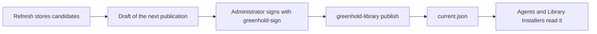

A **library** holds the software that you deploy.
A library keeps **packages**.
A package is one piece of software with its stored versions.

A library does not depend on the server.
You can use a library with agents, with the Library Installer on image masters, or with both.

:::note
Without a license, you can add at most 5 packages to a library.
A license removes this limit.
:::

## Where a library lives

| Place | Address | Notes |
|---|---|---|
| Folder or file share | A full path or a UNC path | Use a Windows file share with SMB 2 or later. Greenhold refuses a share that cannot lock files in the right way. |
| Azure Blob | `https://<account>.blob.core.windows.net/<container>[/<folder>]` | Use a storage account with account key access turned off. The writer signs in with a certificate or a managed identity. |

The layout is the same in both places.
These items are the main ones:

| Item | Content |
|---|---|
| `library.json` | The ID of the library and the ID of the installation. |
| `catalog/` | The packages that you want, with their sources and settings. |
| `packages/` | The stored versions of each package, with the installer files. |
| `publication/` | The signed publication, the draft that waits, and the revocation list. |
| `library-installer/` | The Library Installer, in sets. Each version has its own folder. |
| `logs/` | The logs of each refresh and each automatic publication. |

Storage access decides who can read and change the files.
The signature of an administrator decides what a reader accepts.
A person who can write to the library cannot make a computer install something that no administrator signed.

## Sources

A package has a **source**.
The source tells the refresh where to find new versions.
A source is a query.
It is never code that you write.

| Source | Finds |
|---|---|
| WinGet | The latest version in the signed index of WinGet. |
| URL | A file at a fixed `https` address. Greenhold reads the version from the file. |
| PowerShell module | The result of Evergreen, Nevergreen or VcRedist. |
| None | You add each version by hand. |

:::caution
Evergreen and Nevergreen run code that they fetch.
They run it as the account of the scheduled refresh.
Give that account no other rights.
:::

## Refresh

A **refresh** is one run without a person.
It does these things:

1. It checks the source of each package.
2. It downloads new versions and stores them as **candidates**.
3. It checks the signature of each installer.
4. It writes a draft of the next publication with the candidates that are ready.
5. It removes old files by the retention rules.

A refresh never publishes.
A candidate is ready when its **cool-off** time is over.
You set the cool-off time in days.

Schedule the refresh with `greenhold-library schedule`.
Run it as an account that is not an administrator.

A refresh refuses a download from a private, loopback or link-local address.
To allow an internal mirror, set `AllowedInternalAddresses` in the policy of the refresh computer.

## Drafts, signing and publications

A **publication** states which versions the library offers.
Computers install only what a verified publication names.

1. Run `greenhold-library draft`, or use the draft that the refresh wrote.
2. Sign the draft: `greenhold-sign sign --kind publication`. Do this on your own computer. The tool lists every change before it asks for your passphrase.
3. Publish the signed file: `greenhold-library publish --file publication.signed`.

A publication has a sequence number that rises.
A reader refuses a lower sequence than the one it accepted.
A publication stops to count when its validity ends, or when the certificate of its signer ends.
The default validity is 180 days.
The longest validity is 366 days.
Sign a renewal before the end.

The Manager shows each library on the pages **Overview**, **Draft**, **Publish** and **Last refresh**.
The Manager does not sign.

### Automatic publication

A library can also publish **automatically**.
See [The automatic publisher](/library/automatic-publisher/).

## Next

- [Create a library and add a package](/library/create-a-library/)
- [Install a package on a device](/library/install-a-package/)
- [The Library Installer for images](/library/library-installer/)
- [Azure Blob libraries](/library/azure-blob/)
