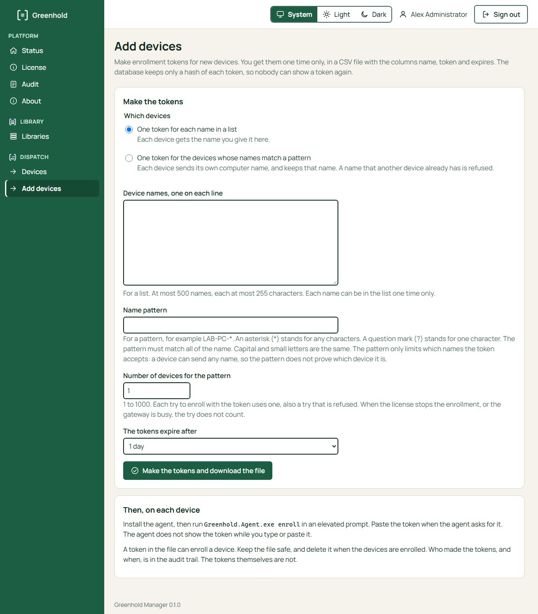

import { Tabs, TabItem } from '@astrojs/starlight/components';

A device needs an enrollment token one time, to enroll.
After that, it uses its own certificate.
You can make the tokens in the Manager or on the command line.

A token is a secret.
Anyone who has a token can enroll a device with it.
Greenhold keeps only a hash of each token.
Nobody can show a token again.

## Choose the kind of token

| Kind | Use it for | The device's name |
|---|---|---|
| One token for each name | A few devices whose names you know. | The device gets the name that you give. |
| One token for a name pattern | Many devices whose names follow a pattern, for example `LAB-PC-*`. | The device sends its own computer name and keeps it. |

A name pattern has two special characters:

- An asterisk (`*`) stands for any characters.
- A question mark (`?`) stands for one character.

The pattern must match the whole name.
Capital and small letters are the same.

:::caution[A pattern is a filter, not a proof]
The device states its own name.
A device that has the token can send any name that matches the pattern.
The pattern does not prove which device it is.
:::

The gateway refuses a name that another device already has.
A revoked device does not keep its name, so a computer that you set up again can use it.

Each try to enroll with a pattern token uses one of its devices, also a try that is refused.
A try does not count when the license stops the enrollment or when the gateway is busy.

## Make the tokens

<Tabs syncKey="interface">
<TabItem label="GUI">

You must be an Administrator in the Manager.

1. In the Manager, open **Add devices**. You also find the button **Add devices** on the **Devices** page.
2. Under **Which devices**, choose one of these:
   - **One token for each name in a list**. Type the names in **Device names, one on each line**. You can give at most 500 names. Each name has at most 255 characters.
   - **One token for the devices whose names match a pattern**. Type the pattern in **Name pattern**. Type the number of devices in **Number of devices for the pattern**: 1 to 1000.
3. In **The tokens expire after**, choose a time from 1 hour to 7 days.
4. Choose **Make the tokens and download the file**.



You get a CSV file with the columns `name`, `token` and `expires`.
You get the file one time only.
The Manager does not keep the tokens.

</TabItem>
<TabItem label="CLI">

On the Greenhold server, open an elevated PowerShell:

```powershell
cd "C:\Program Files\Greenhold\Gateway"
```

A token for one name:

```powershell
.\Greenhold.Gateway.exe token new --name PC-01 --lifetime 1.00:00:00 > token.txt
```

A token for a name pattern and 40 devices:

```powershell
.\Greenhold.Gateway.exe token new --pattern "LAB-PC-*" --uses 40 --lifetime 1.00:00:00 > token.txt
```

| Option | Meaning |
|---|---|
| `--name <name>` | The token is for one device with this name. |
| `--pattern <pattern>` | The token is for devices whose names match the pattern. |
| `--uses <n>` | With `--pattern`: the number of devices, 1 to 1000. The default is 1. |
| `--lifetime <d.hh:mm:ss>` | How long the token works. At most 7 days. |

The command shows the token one time.
Write it to a file, as above.

</TabItem>
</Tabs>

## Enroll the devices

Install the agent on each device first.
See [Enroll your first device](/get-started/enroll-your-first-device/).

On the device, open an elevated prompt and run:

```powershell
& "C:\Program Files\Greenhold\Agent\Greenhold.Agent.exe" enroll
```

The agent asks for the token.
Paste the token from the CSV file.
The agent does not show the token while you type or paste it.

The agent prints one line, for example:

```
Enrolled. Device ID: <device id>. Key protection: TPM.
```

:::note
Never put a token on the command line.
`enroll` refuses a token as an argument.
:::

To enroll from a script, give the token on standard input:

```powershell
Get-Content token.txt | & "C:\Program Files\Greenhold\Agent\Greenhold.Agent.exe" enroll
Remove-Item token.txt
```

## Keep the file safe

- A token in the file can enroll a device until it expires.
- Keep the file in a folder that only administrators can read.
- Delete the file when the devices are enrolled.
- The audit trail records who made the tokens, and when. It does not record the tokens.

When many devices use one pattern token at the same time, the gateway can answer "busy".
The agent then tries again by itself after a short wait.
The token does not change.

## Next

- [Revoke or forget a device](/manager/revoke-and-forget/)
- [Run a PowerShell script on a device](/dispatch/run-a-powershell-script/)
