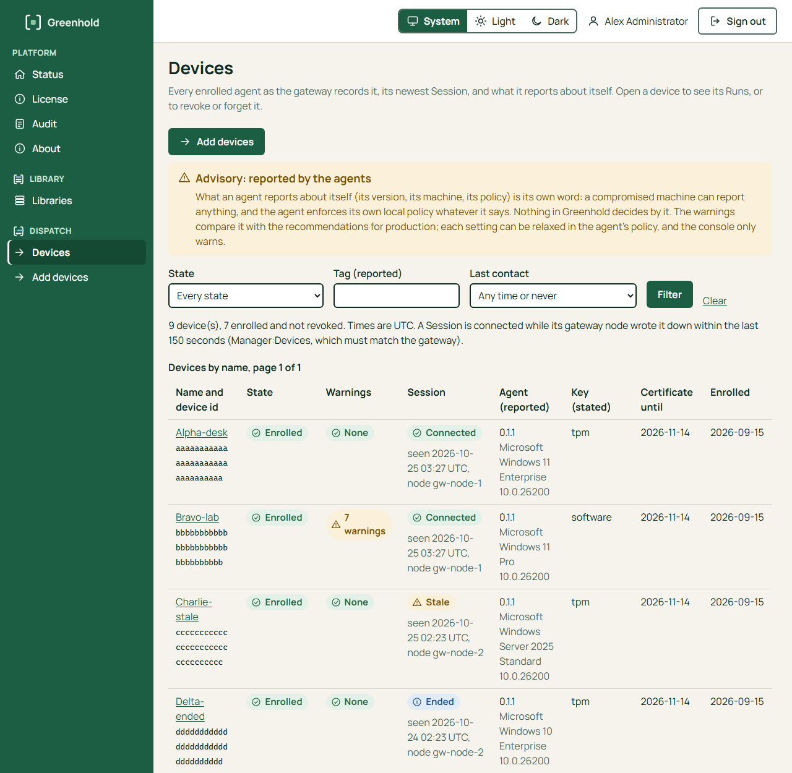
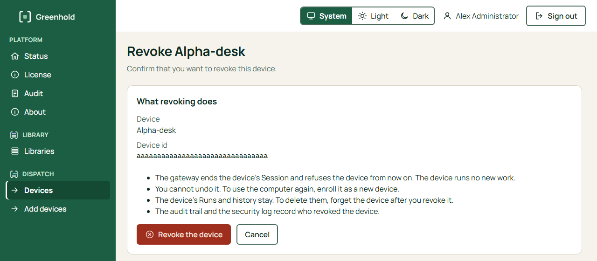
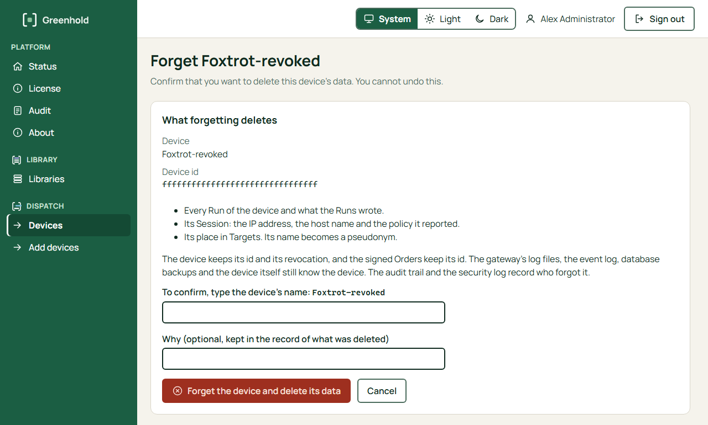

import { Tabs, TabItem } from '@astrojs/starlight/components';

Use **Revoke** when a device must not run work again.
For example, the computer is lost, stolen or given away.
Use **Forget** after Revoke, when you must also delete the data of the device.

| Action | What it does | Can you undo it? |
|---|---|---|
| Revoke | The gateway ends the Session of the device and refuses the device from now on. The device runs no new work. Its Runs and history stay. | No. To use the computer again, enroll it as a new device. |
| Forget | Deletes every Run of the device and what the Runs wrote, its Session data (the IP address, the host name and the policy it reported), and its place in Targets. Its name becomes a pseudonym. | No. |

Forget works only for a revoked device.
The device keeps its ID and its revocation.
Signed Orders keep its ID.
The gateway's log files, the event log, database backups and the device itself still know the device.

The audit trail and the security log record who revoked or forgot the device.

## Find the device

<Tabs syncKey="interface">
<TabItem label="GUI">

1. In the Manager, open **Devices**.
2. To find a device, use the filters: **State**, **Tag (reported)** and **Last contact**. Choose **Filter**.
3. Choose the name of the device. The device page shows its details and its Runs.



</TabItem>
<TabItem label="CLI">

On the Greenhold server, in an elevated PowerShell:

```powershell
cd "C:\Program Files\Greenhold\Gateway"
.\Greenhold.Gateway.exe agent list --wide
```

`--wide` shows the whole device ID.
Revoke and Forget need the whole ID.

</TabItem>
</Tabs>

## Revoke a device

<Tabs syncKey="interface">
<TabItem label="GUI">

You must be an Administrator in the Manager.

1. On the device page, choose **Revoke**.
2. Read **What revoking does**. Check the name and the device ID.
3. Choose **Revoke the device**.



The Devices page shows the state **Revoked**.

</TabItem>
<TabItem label="CLI">

```powershell
.\Greenhold.Gateway.exe agent revoke <device id>
```

</TabItem>
</Tabs>

## Forget a device

<Tabs syncKey="interface">
<TabItem label="GUI">

You must be an Administrator in the Manager.
Revoke the device first.

1. On the device page, choose **Forget**.
2. Read **What forgetting deletes**.
3. In **To confirm, type the device's name**, type the name exactly as the page shows it.
4. Optional: in **Why**, type a reason. Use a reference number, not the name of a person. The reason stays in the record of what was deleted.
5. Choose **Forget the device and delete its data**.



For a device that the gateway suspects to be a clone, the page also asks you to tick a box.

</TabItem>
<TabItem label="CLI">

```powershell
.\Greenhold.Gateway.exe agent forget <device id> --yes --note "request 2026-17"
```

The command uses the connection string of the migration role (`gh_migrator`).
`--note` is kept for ever.
Use a reference number, not the name of a person.
For a device that the gateway suspects to be a clone, add `--include-clone-suspected`.

</TabItem>
</Tabs>

## Next

- [Add devices](/manager/add-devices/)
- [Run output and retention](/dispatch/run-output-and-retention/)
