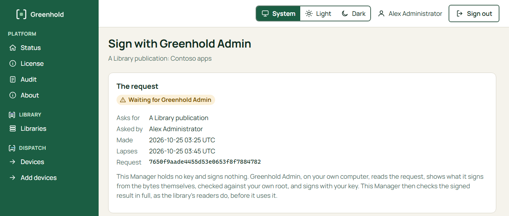
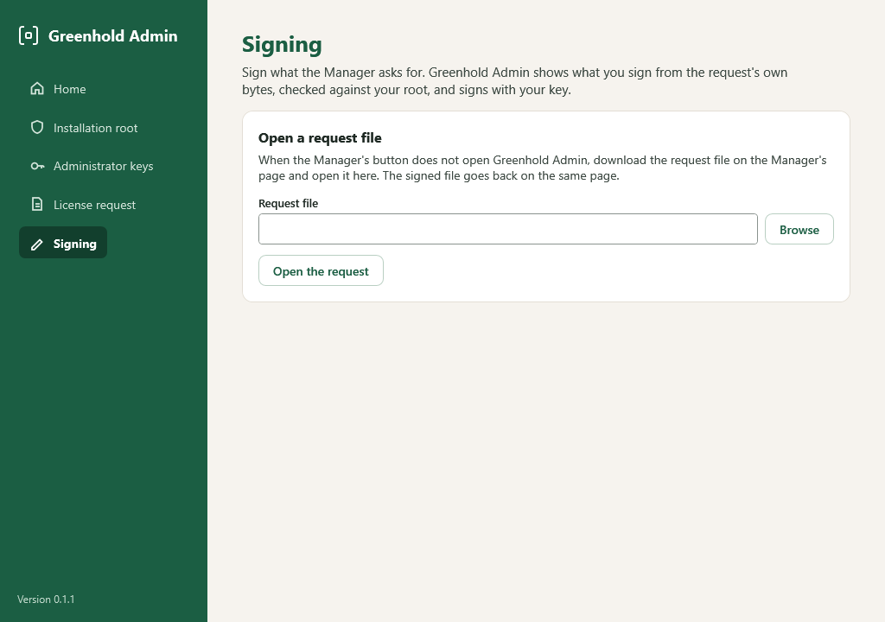

import { Tabs, TabItem } from '@astrojs/starlight/components';

The Manager holds no key and signs nothing.
When a task needs your signature, the Manager makes a **signing request**.
Greenhold Admin signs the request on your own computer, with your key.
Then the Manager checks the signed result in full before it uses it.

These tasks use a signing request:

| Task | Where it starts in the Manager |
|---|---|
| Publish a library | The library's **Draft** page: **Sign and publish**. |
| Approve an app and keep it current | The app's page: **Approve ... and keep current**. |
| Certify the automatic publisher's key | The library's **Automatic publishing** page. Only the root holder does this. |
| Sign a job (a Release, then an Order) | The job's page. |
| Sign a job as the second administrator | The job's page: **Sign as the second administrator**. |

## Before you start

- Install Greenhold Admin on your own computer. See [Greenhold Admin](/get-started/admin-tools/).
- Have a certified administrator key. See [Administrator keys](/get-started/administrator-keys/).
- Open the Manager at its `https` address. Greenhold Admin connects to a Manager over HTTPS only.

## Sign a request

<Tabs syncKey="interface">
<TabItem label="GUI">

1. Start the task in the Manager. The Manager shows the page **Sign with Greenhold Admin**.
2. Read **The request**: what it asks for, who asked, when it was made and when it lapses.
3. Choose **Sign with Greenhold Admin**. Your browser asks to open Greenhold Admin. Allow it.
4. **The first time** a Manager sends you a link, Greenhold Admin shows the Manager's address. Choose **Trust this Manager and continue** only if it is your installation's Manager, at the address you always use. Greenhold Admin remembers your choice. Otherwise choose **Do not trust it**: Greenhold Admin fetches nothing.
5. Greenhold Admin shows **What you sign**. Read all of it. See [What you see before you sign](#what-you-see-before-you-sign).
6. Choose your key. A key in the TPM or on a security key asks for its PIN. A key file asks for its passphrase.
7. Choose **Sign and send to the Manager**.
8. Greenhold Admin shows the Manager's answer. In the Manager, choose **Check for the result**.

</TabItem>
<TabItem label="CLI">

`greenhold-sign` signs the same objects on the command line.
Use it in scripts.

| Task | Commands |
|---|---|
| Publish a library | `greenhold-sign sign --kind publication`, then `greenhold-library publish`. See [Create a library](/library/create-a-library/). |
| Sign a job | `greenhold-sign sign --kind release`, `hash`, `sign --kind order`, then `Greenhold.Gateway order add`. See [Run a PowerShell script](/dispatch/run-a-powershell-script/). |
| Second signer | `greenhold-sign sign --add-to`. See [Second signer and tags](/dispatch/second-signer-and-tags/). |
| Certify the automatic publisher's key | `greenhold-sign automation-certify`. See [Keep apps current](/library/keep-apps-current/). |

</TabItem>
</Tabs>

## The link

The button **Sign with Greenhold Admin** opens a `greenhold://` link.
The Greenhold Admin installer registers this link for every user of the computer.

The link is safe to use for these reasons:

- It works **one time**, and only for you.
- It lapses after **20 minutes**.
- It stops working when you sign out of the Manager.
- Greenhold Admin fetches nothing from a Manager that you did not confirm.
- Greenhold Admin connects over HTTPS only. The Manager's certificate must be one that Windows trusts. Greenhold Admin follows no redirect.

Greenhold Admin refuses a request for another installation, a request from another Manager than the link named, and a request that lapsed.

To stop trusting a Manager, remove it from `TrustedManagers` in `%LOCALAPPDATA%\Greenhold\AdminTools\settings.json`.

## What you see before you sign

Greenhold Admin does not trust the request.
It works out what you sign from the bytes of the request itself.
It checks them against your own installation root.
Then it signs exactly those bytes.

| Request | What you see |
|---|---|
| A library publication | The library, the sequence, what it follows, and every change to every package and version. |
| A job's Release | The job, its version and the **whole script**, with its SHA-256 checked against the script. For a package: the package, the version and the SHA-256 of the installer. |
| A job's Order | The Release it names (signed, and checked against your root), every device by ID, the start and the end. |
| A second signature | The same Order, and who signed it already. |

For an Order, a name in brackets after a device ID is what the Manager calls the device.
The name is not part of what you sign.

### The whole script

**What you sign** shows the whole script, up to 1 MiB, in a box that scrolls.
The sign button stays off until you scroll to the end of the box or choose **Show the whole script**.
When all of it fits in the box, or when you have seen the end, the button **Show the whole script** goes away.
The **Key file passphrase** box shows only when you choose a key file.
For a publication, the button is **Show all of it**.
A signature says that you saw what runs.

### The encoding rule

The agent runs a script with Windows PowerShell 5.1.
Windows PowerShell 5.1 reads a file without a byte order mark (BOM) in the ANSI code page of the device.
The same bytes can then mean other text than you see.

For this reason, Greenhold Admin and the Manager read a script as Windows PowerShell 5.1 reads it:

- A script with a UTF-8 or UTF-16 BOM is read in the encoding that the BOM names.
- A script without a BOM is accepted only when it has plain ASCII characters only.
- Any other script is refused. The message starts with "This script has characters that Windows PowerShell may read differently".

The Manager puts a UTF-8 BOM in front of every script without a BOM that you upload or paste, and keeps it so.
Thus a pasted script, and a file saved as UTF-8, are accepted.
A file saved in an ANSI code page, with characters other than plain ASCII, is refused.
To correct a refused script, save it as **UTF-8 with BOM**.

On the command line, `greenhold-sign` adds no BOM.
Save a script with characters other than plain ASCII as **UTF-8 with BOM** before you sign it.

## Sign without the link

Use this way when the browser does not open Greenhold Admin, or when the Manager runs on plain `http` in a lab.

<Tabs syncKey="interface">
<TabItem label="GUI">

1. On the request page in the Manager, choose **Download the request file**.
2. In Greenhold Admin, open **Signing**.
3. Under **Open a request file**, choose the file and choose **Open the request**.
4. Read **What you sign**, choose your key and sign. Save the signed file.
5. In the Manager, under **Without the link**, choose **Signed file** and select the file. Choose **Upload the signed file**.

</TabItem>
<TabItem label="CLI">

Use `greenhold-sign` with the files of the task, as the table under [Sign a request](#sign-a-request) shows.

</TabItem>
</Tabs>

To stop a request, choose **Cancel this request** on the request page.

## What Greenhold Admin keeps

Greenhold Admin keeps a memory of each library's publications in the folder `library-memory` in your keys folder.
With it, Greenhold Admin never signs over an older publication that somebody put back.
Keep this folder with your keys.
